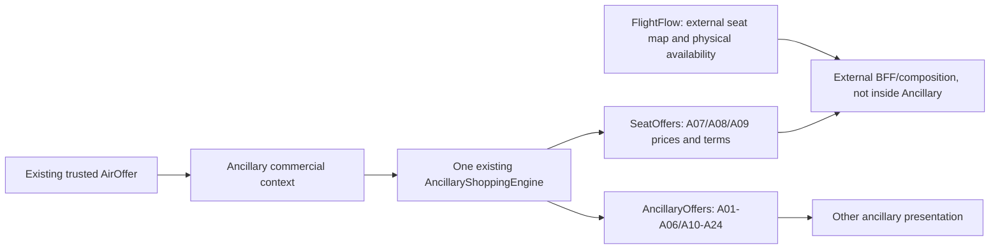

# 01 — Final architecture decisions v12.3

| ID | Decision | Reason |
|---|---|---|
| ADR-01 | Retain one ServiceDefinition AR, one Provision AR, one Pricing AR, nine typed Specs and A01–A24 | Single commercial model, no 24 duplicated aggregates |
| ADR-02 | Retain **one already implemented Shopping Engine** and canonical candidates | Shopping is P2 implemented, not P3 pending; avoid duplication and regression |
| ADR-03 | Expose **separate SeatOffers and other AncillaryOffers routes**, for Api/OtaPanel/Backoffice; family-specific mappings, shared execution | Distinct Seat UI and price-by-seat-type output; industry separates SeatAvailability/Seatmap from service listing |
| ADR-04 | Ancillary SeatOffers never returns physical seat inventory, a live SeatMap, `AVAILABLE/OCCUPIED`, or guarantees | Only FlightFlow can assert physical occupancy; Ancillary owns commercial price/eligibility |
| ADR-05 | Seat **has no AncillaryInventoryPolicy**: Create/Change/Activate forbidden; query/snapshot Shopping does not require it | A saleable commercial price must not depend on an external provider's inventory publication |
| ADR-06 | Never silently interpret missing Seat price as free; only `PriceOrigin=Free` qualifies. Missing/invalid pricing fails closed | Zero amount cannot be a fallback for unavailable pricing |
| ADR-07 | Canonical Seat Candidate pricing is per eligible product/rule/traveller/flight/coverage. **Per-number** price requires trusted seat characteristics/seat number input, not guessed from AirOffer | Seatmap is an external source; characteristics are already modeled in `SeatCharacteristicFacts` |
| ADR-08 | Separate API surface routes, **do not fork Shopping engine** or create new Seat price tables | Proven current reuse: `AncillaryShoppingEngine`, `GetAncillaryOffersService`, per-surface mappers |
| ADR-09 | Remove broken Ancillary `/AncillaryOffers/SeatMaps` handlers and `IFlightSeatMapReference`; do not proxy/rename FlightFlow map inside Ancillary | Current implementation always throws SeatMapSourceUnavailable |
| ADR-10 | Remove live FlightFlow-specific policy authority/member/port, DI and `InventoryReferenceProbe` FlightFlow function | Eliminate direct seat provider dependency in core |
| ADR-11 | Keep non-Seat `AncillaryInventoryPolicy`: Unlimited / Local / Supplier, true FlightCount/FlightWeight/AirportSlot and PassengerUsageLimits | Other services can genuinely have independently controlled capacity |
| ADR-12 | Generic flight occurrence reference for non-Seat Count/Weight: preserve **concept** but not hardcoded FlightFlow HTTP adapter; offline missing valid source must stay blocked | Separates generic identifiers from specific external infrastructure |
| ADR-13 | `MustCheckAvailability` is sales/eligibility metadata, **not proof of inventory**. It must not block commercial Seat pricing when no Ancillary policy | One flag must not silently create inventory ownership |
| ADR-14 | Current no-POS-filter rule stays supported. Empty POS set means unrestricted **among authorized callers** | HEAD `8fda5f1e` expressly removed mandatory POS |
| ADR-15 | Existing Seat A07/A08/A09 typed spec, seat characteristic selection rule and `PerSeat` pricing retained, no seat-number occupancy persisted | Domain intent remains useful even without SeatMap |
| ADR-16 | Existing P3 Hold/Confirmation/Reservation routes stay unchanged and unclaimed as complete | Owner prohibited P3 now |
| ADR-17 | No historical data constraints; simplify migrations/contracts/tests cleanly | Owner stated greenfield; don't encumber agent with old-record migration |
| ADR-18 | Only Ancillary repository changed; no FlightFlow, AirOffer, AirPrice, Ordering repository changes | Explicit service boundary |

## Logical flow and ownership

**Important:** Arrow into the external BFF describes responsibility separation, not an instruction to implement a BFF/FlightFlow API in this Ancillary pack. Neither public Amadeus nor IATA APIs prove Amadeus internal microservice topology; this is an AeroTech architectural decision. Industry evidence for separate consumer products is recorded in `16`.

## Explicit no-duplication rule
Implement family scoping in shared query orchestration via a narrow explicit filter; do not query all families and merely hide unmatched candidates AFTER calculation if that runs unnecessary policy/evidence calls. The generic canonical engine already supports `ShoppingFilter.Profiles`; reuse it. Family-specific DTOs may project from same canonical result. Do not create `SeatPricingEngine`, `SeatRulesEngine` or duplicate external context readers.
