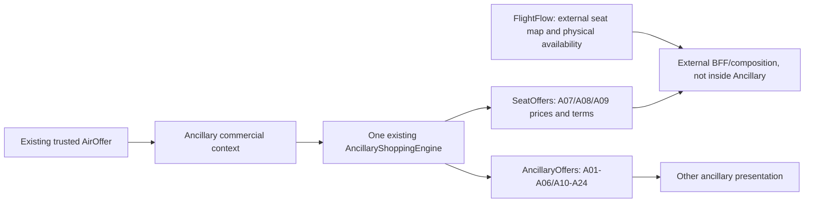

# AeroTech Ancillary v12.3 — COMPLETE PROJECT AUTHORITY

This file concatenates the eighteen binding chapters exactly, with section dividers. Individual chapter files are also included in the ZIP.


---

# AeroTech Ancillary v12.3 — Single Project Authority

**State:** approved design to be implemented and verified by Backend Agent, not a claim that code is already deployed. **Date:** 2026-10-13. **Repo:** `aliifarhadi/AeroTech.Ancillary`; **branch:** `k8s-stg`; **reviewed HEAD:** `8fda5f1e8c2586a08fa995a0f8701e9299182986` (`Fix. Remove POS Mandatory`). Recheck real HEAD first. Work ONLY in this repository.

## Single authority
This COMPLETE v12.3 pack is self-contained, and replaces conflicting parts of v12.2 and all earlier Seat Inventory addenda. No need to consult previous packs for business decisions. The actual code determines retained API names, EF patterns and exact build/test mechanics; v12.3 determines desired behavior. No agent may silently substitute donor conventions for this pack. Owner approves architecture and scope; coding agent implements, tests, reports.

## Exact scope: existing phases, not new reservations
**P1:** typed authoring, Definition, Provision, Pricing, lifecycle and nine profiles A01–A24. **P2:** already-implemented Shopping/AncillaryOffers, selection-evaluation and inventory configuration for non-Seat products. **Both P1 and P2 are in scope for targeted correction and regression.** Previous v12.2 texts claiming all Shopping is merely future P3 are superseded. **P3:** Hold, Reservation, Confirm, Release, Order mutation, seat assignment, fulfilment, EMD issuance: OUT OF SCOPE; do not edit these flows or their contract.

## Architectural decision
- Seat A07/A08/A09: commercial Definition/Provision/Pricing and Seat-only Shopping price offers in Ancillary. No AncillaryInventoryPolicy, no Seat stock, no mandatory inventory, no FlightFlow provider key or call. Seat availability, layout and actual seat characteristics belong to external FlightFlow; composition is external to Ancillary.
- Shopping **has one existing canonical `AncillaryShoppingEngine`**, retained. Public/surface route outputs separated: `SeatOffers` for Seat commercial prices and `AncillaryOffers` for other services. **No second Shopping engine**; no duplicate rule/pricing implementations. Remove broken Ancillary `SeatMaps` stub. Preserve `Details` and `Selections/Evaluate` on the correct family surface, with ownership checks and no cross-family discovery.
- Other profiles: physical Count/Weight/Slot, Supplier authority and optional explicit Unlimited policies are still supported. An absent non-Seat policy != Unlimited. An absent Seat policy is **NotApplicable**, not NotConfigured/Unknown.
- There must be no direct **runtime source-code** reference/HTTP client/configuration for FlightFlow in Ancillary after change. Generic flight-identity/aircraft facts used in commercial rules are **not** the FlightFlow dependency; remove the hardcoded FlightFlow HTTP adapter but preserve correct external reference validation of non-Seat flight-based Count/Weight sources if authoritative replacement exists. Never fake `Verified`.

## Current source decisions to retain
`SalesRestrictions == null` or empty `PointsOfSale` means no POS restriction; nonempty list restricts matching POS. HEAD intentionally removed mandatory POS publication. Preserve `PricingUnit.PerSeat=5`, `ServiceCoverageScope.Portion=2`, all other existing enum values; do not reintroduce the old POS mandate.

## Greenfield assumption
Owner states **NO historical production data**. Agent may remove obsolete migrations, enum member `InventoryAuthority.FlightFlow=4`, obsolete schema/fixtures and stale tests and build a clean current-schema migration. **No data-preservation, legacy compatibility, dual-write or costly expand/contract work**. But do not delete working non-Seat Inventory and do not destroy unrelated tests: current SQL correctness, baseline smoke and compiler/contract compatibility still must pass.

## Deliverables and acceptance
- Real code changes in Ancillary only; migrations/schema and DI corrected, zero dangling FlightFlow dependencies in `src`.
- Seat Definition, Provision, Pricing, Pricing revisions, Shopping pricing and selection evaluation work without any Seat InventoryPolicy and without a FlightFlow connection.
- Three surfaces each expose working, properly authorized separated SeatOffers and non-Seat AncillaryOffers, no broken SeatMap proxy; real HTTP and SQL regression.
- All nine profiles / 24 scenarios and shared rules, fees/tax/currency, non-Seat inventories unaffected; concrete PASS/FAIL evidence, source blockers reported truthfully.
- No implementation of Hold/Confirm/Order. No code changes outside Ancillary repository. A final agent report with current SHA, file diff, test results, known blockers and exact endpoints.

## Read order
`01` decisions, `02` domain graph, `03` nine profiles and A01–A24, `04` Seat exact contract, `05` Provision, `06` Pricing, `07` non-Seat inventory, `08` Backoffice, `09` **existing Shopping and new SeatOffers route**, `10` DB, `11` tests, `12` exact source edits, `13` **BACKEND AGENT PROMPT**, `14` frontend contract, `15` continuation, `16` evidence, `17` enums. The full combined copy is `AeroTech-Ancillary-v12.3-COMPLETE.md`.


---

# 01 — Final architecture decisions v12.3

| ID | Decision | Reason |
|---|---|---|
| ADR-01 | Retain one ServiceDefinition AR, one Provision AR, one Pricing AR, nine typed Specs and A01–A24 | Single commercial model, no 24 duplicated aggregates |
| ADR-02 | Retain **one already implemented Shopping Engine** and canonical candidates | Shopping is P2 implemented, not P3 pending; avoid duplication and regression |
| ADR-03 | Expose **separate SeatOffers and other AncillaryOffers routes**, for Api/OtaPanel/Backoffice; family-specific mappings, shared execution | Distinct Seat UI and price-by-seat-type output; industry separates SeatAvailability/Seatmap from service listing |
| ADR-04 | Ancillary SeatOffers never returns physical seat inventory, a live SeatMap, `AVAILABLE/OCCUPIED`, or guarantees | Only FlightFlow can assert physical occupancy; Ancillary owns commercial price/eligibility |
| ADR-05 | Seat **has no AncillaryInventoryPolicy**: Create/Change/Activate forbidden; query/snapshot Shopping does not require it | A saleable commercial price must not depend on an external provider's inventory publication |
| ADR-06 | Never silently interpret missing Seat price as free; only `PriceOrigin=Free` qualifies. Missing/invalid pricing fails closed | Zero amount cannot be a fallback for unavailable pricing |
| ADR-07 | Canonical Seat Candidate pricing is per eligible product/rule/traveller/flight/coverage. **Per-number** price requires trusted seat characteristics/seat number input, not guessed from AirOffer | Seatmap is an external source; characteristics are already modeled in `SeatCharacteristicFacts` |
| ADR-08 | Separate API surface routes, **do not fork Shopping engine** or create new Seat price tables | Proven current reuse: `AncillaryShoppingEngine`, `GetAncillaryOffersService`, per-surface mappers |
| ADR-09 | Remove broken Ancillary `/AncillaryOffers/SeatMaps` handlers and `IFlightSeatMapReference`; do not proxy/rename FlightFlow map inside Ancillary | Current implementation always throws SeatMapSourceUnavailable |
| ADR-10 | Remove live FlightFlow-specific policy authority/member/port, DI and `InventoryReferenceProbe` FlightFlow function | Eliminate direct seat provider dependency in core |
| ADR-11 | Keep non-Seat `AncillaryInventoryPolicy`: Unlimited / Local / Supplier, true FlightCount/FlightWeight/AirportSlot and PassengerUsageLimits | Other services can genuinely have independently controlled capacity |
| ADR-12 | Generic flight occurrence reference for non-Seat Count/Weight: preserve **concept** but not hardcoded FlightFlow HTTP adapter; offline missing valid source must stay blocked | Separates generic identifiers from specific external infrastructure |
| ADR-13 | `MustCheckAvailability` is sales/eligibility metadata, **not proof of inventory**. It must not block commercial Seat pricing when no Ancillary policy | One flag must not silently create inventory ownership |
| ADR-14 | Current no-POS-filter rule stays supported. Empty POS set means unrestricted **among authorized callers** | HEAD `8fda5f1e` expressly removed mandatory POS |
| ADR-15 | Existing Seat A07/A08/A09 typed spec, seat characteristic selection rule and `PerSeat` pricing retained, no seat-number occupancy persisted | Domain intent remains useful even without SeatMap |
| ADR-16 | Existing P3 Hold/Confirmation/Reservation routes stay unchanged and unclaimed as complete | Owner prohibited P3 now |
| ADR-17 | No historical data constraints; simplify migrations/contracts/tests cleanly | Owner stated greenfield; don't encumber agent with old-record migration |
| ADR-18 | Only Ancillary repository changed; no FlightFlow, AirOffer, AirPrice, Ordering repository changes | Explicit service boundary |

## Logical flow and ownership



**Important:** Arrow into the external BFF describes responsibility separation, not an instruction to implement a BFF/FlightFlow API in this Ancillary pack. Neither public Amadeus nor IATA APIs prove Amadeus internal microservice topology; this is an AeroTech architectural decision. Industry evidence for separate consumer products is recorded in `16`.

## Explicit no-duplication rule
Implement family scoping in shared query orchestration via a narrow explicit filter; do not query all families and merely hide unmatched candidates AFTER calculation if that runs unnecessary policy/evidence calls. The generic canonical engine already supports `ShoppingFilter.Profiles`; reuse it. Family-specific DTOs may project from same canonical result. Do not create `SeatPricingEngine`, `SeatRulesEngine` or duplicate external context readers.


---

# 02 — Complete domain graph, identities and lifecycle

```text
Supplier AR (current supplier catalogue)
  AncillaryServiceDefinition AR [owner + stable ServiceDefinitionRef + Version]
    one-of-nine typed Specification VO graph
    DocumentDefinition + BookingDefinition + DocumentRouting
    AncillaryProvision AR [version-scoped Definition ID]
      10 shared rule groups (typed children)
      bounded Pet/AssistedTravel/AirportService specialization
      CommercialOutcome / AvailabilityDefinition / Settlement / Fulfillment / Quantity
      AncillaryPricing AR [one Active revision per Provision]
        AncillaryPricingRate (Money + traveller/currency/age selector)
          AncillaryPriceComponent (Tax / Fee)
  AncillaryInventoryPolicy AR [owner + stable ServiceDefinitionRef; NON-SEAT only]
    Optional PassengerUsageLimit[]
    optional typed Local Count/Weight/Slot source bindings, or Supplier authority
  FlightCountInventory AR [owner + FlightId + resource id; non-seat quotas]
  FlightWeightInventory AR [owner + FlightId + resource id; non-seat quotas]
  AirportSlotInventory AR [owner + facility/time interval; non-seat quotas]

AncillaryReservation AR — EXISTS but frozen / out of scope in P1/P2.
No SeatInventory, SeatMapCache, SeatStock, SeatAvailability, FlightFlow Provider/Policy or SeatHold AR.
```

| AR | Identity / core scalar fields | Child facts | State |
|---|---|---|---|
| `Supplier` | `Id:long`, OwnerAirlineId, FulfillmentKind, FulfillmentProviderKey, Name | existing | existing lifecycle unchanged |
| `AncillaryServiceDefinition` | `Id:long`; `(OwnerAirlineId:int,ServiceDefinitionRef:string(30),Version:int)`; SupplierId, ServiceTypeCode(1), ServiceSubCode(3), SubCodeSource, GroupCode(2), SubGroupCode?, Description1Code?, Description2Code?, Profile, VariantCode(A01..A24), CommercialName(100), Description?(500), PricingUnit, ServiceDateBasis, SalesEffectiveFrom?, SalesDiscontinueOn?, status+timestamps | one of 9 spec graphs, booking, document | Draft editable; Active immutable; Revise new Draft; Suspend/Reactivate/Retire |
| `AncillaryProvision` | Id, ServiceDefinitionId, Sequence, CoverageScope, PurchaseStage, PriceOrigin, QuoteProviderKey?, ApplicationType, Quantity, Outcome, Settlement, Availability, Fulfillment, status+timestamps | all existing 10 rules, typed applicable rules, SalesRestrictions optional POS | Draft editable; Active immutable; Publish/Activate/Suspend/Revise/Retire |
| `AncillaryPricing` | Id, AncillaryProvisionId, Version, PricingUnit, Status, timestamps | Rate(s), components and Money | ≤1 Active version per Provision; immutable Active, revise data faithfully |
| `AncillaryInventoryPolicy` | Id, OwnerAirlineId, ServiceDefinitionRef, ServiceDefinitionId diagnostic current pointer, Authority (`Unlimited|Local|Supplier`), LocalPattern?, ProviderKey?, version/status/timestamps | CountConsumption?, WeightConsumption?, SlotConsumption?, PassengerUsageLimits[] | **Not constructible for Seat**; Draft→Active/Suspended/Retired |
| `FlightCountInventory` | Id, OwnerAirlineId, FlightId, ResourceId, CountUnit, TotalCapacity:int>=0, ClosedForSale, Status/Version/rowversion | append-only count adjustments | nonSeat resource; optimistic concurrency |
| `FlightWeightInventory` | Id, OwnerAirlineId, FlightId, WeightResourceId, CapacityKg:decimal(18,3)>=0, status/version | append-only weight adjustments | nonSeat; **not flight safety weight** |
| `AirportSlotInventory` | Id, OwnerAirlineId, AirportId, FacilityId, StartUtc, EndUtc, CapacityPersons>=0, status/version | append-only slot adjustments | half-open UTC intervals; no overlaps |

### Cross-root invariants
1. Exactly one matching typed Specification per Active Definition, correct Profile/Variant; no untyped JSON/EAV.
2. Stable ref can have versioned revisions; Active changes by Revise, never mutate profile/variant under same stable product identity.
3. Provision references a specific Definition version; Pricing references one Provision; **no physical-stock FK on Seat**.
4. Current nonSeat policy keyed by `(OwnerAirlineId, ServiceDefinitionRef)`, shared across legitimate Definition revisions; its diagnostic ID pointer is not a seat count.
5. `SalesRestrictions.PointsOfSale` null or empty is unrestricted among authorized POS; nonempty means filter. `Sequence` deterministic winner, no ambiguous overlapping active rule.
6. `QuantityRule` MinQuantity>=1 and accepted Max>=Min. UI displaying zero as “not selected” never means sell quantity zero.
7. `ServiceCoverageScope.Portion=2` means relevant portion/bound mapping; don't introduce `Bound` enum alias.
8. Profile-specific children of the wrong family must be rejected; related shared Rule groups must round-trip completely, including `TravelDate.BlackoutPeriods`.
9. Monetary and tax rules remain Pricing-owned; Provider fulfillment declaration is NOT physical-seat authority.
10. No new user selection records in Definition/Provision; runtime buyer selections are future P3 only.


---

# 03 — Exact A01–A24 commercial authoring and P2 shopping coverage

**Uniform contract for every row:** one commercial Definition typed `Specification` + shared metadata, any applicable Provision rules (not obligatorily POS-bound), either filed Pricing/ExternalQuote/Free/NotAvailable, an existing P2 Shopping offer/selection evaluation, and a test for foreign fields. No P3 allocation implementation.

| Variant | Profile | Definition fields / policy | Sale/selection/price scope | InventoryPolicy in Ancillary? |
|---|---|---|---|---|
| A01 Extra checked bag | Baggage | ChargeKind=ExtraPiece; allowance concept Piece; MaxKgPerPiece? | Paid per piece, first/last excess ordinal in Provision | Explicit Unlimited, Supplier or justified local resource |
| A02 Extra weight package | Baggage | WeightPackage, PackageWeightKg (e.g. 5/10), Weight concept | Purchased package qty PerItem; quantity ≠ kg | Explicit Unlimited/Supplier, not fake plane weight capacity |
| A03 Overweight | Baggage | Overweight; exclusive/inclusive weight band | Weight/per-piece surcharge, measured bag predicate | Supplier/verified local only if real physical quota |
| A04 Oversize | Baggage | dimensions/linear sum; charge combination | PerPiece; overlap with A03 controlled | Same strict nonSeat inventory options |
| A05 Cabin bag | Baggage | CabinBag variant + existing ExtraPiece kind; cabin dimensional terms | PerPiece | Not inferred as physical aircraft stock |
| A06 Special equipment | Baggage | EquipmentKind/max weight and size | PerItem/PerPiece; equipment selector | Supplier or genuine Count/Weight resource |
| A07 StandardSeat | Seat | SeatPurpose=Standard; optional characteristic/cabins/exit row | PerSeat Filed or Free, traveller+flight, optional specific seat selection | **NO — not applicable** |
| A08 PreferredSeat | Seat | SeatPurpose=Preferred; **nonempty characteristic codes**; cabin/exit row | PerSeat, traveller+flight, matching actual characteristic only if trusted | **NO — not applicable** |
| A09 ExtraSeat | Seat | Purpose EXST/CBBG, RequiresAdjacentSeat?, ExtraOccupiedSeatCount>=1, ticket-routing declaration | PerSeat; actual seat allocation EXTERNAL and future P3 | **NO — not applicable** |
| A10 Cabin upgrade | Upgrade | from/to cabin distinct, fixed/quote/reprice, exchange metadata | Filed only for real fixed product; else trusted ExternalQuote | Never fake Seat stock; nonSeat policy only if genuine independent quota |
| A11 Free special meal | Meal | SSR meal code, cutoff, exclusive family | Free, no rate, supplier approval possible | Explicit Unlimited+check or Supplier; no invented count |
| A12 Paid preorder meal | Meal | MenuItemRef, dietary code, lead time | Paid PerItem/PerPassenger Filed or supported quote | Supplier/verified local Count if genuine |
| A13 PETC | Pet | species, combined weight, carrier dimensions, age, documents | PerItem; external confirmation | Supplier/true carrier-flight Count |
| A14 PET in hold | Pet | species/weight/size bracket, docs, mode Hold | PerItem or valid quote | Supplier or real Count+Weight |
| A15 Wheelchair | AssistedTravel | SSR WCHR/WCHS/WCHC distinct levels, cutoff | Free, confirmation possibly required | Unlimited+check / supplier; not guaranteed |
| A16 Disability assistance | AssistedTravel | allowed SSR codes/communication | Free or approved filed | Unlimited+check / supplier |
| A17 Medical equipment | AssistedTravel | equipment kind, MEDA/AOXY/STCR, medical docs, approval | Free/Filed/ExternalQuote based on actual airline | Supplier/real equipment quota |
| A18 Bassinet | AssistedTravel | infant weight/age/guardian, compatible groups | Free or Filed | Verified bassinet quota / Supplier; seat map itself external |
| A19 UMNR | AssistedTravel | age range, handoff, connection restrictions | charge policy by child/route | Supplier/true capacity or explicit nonfinite check |
| A20 Lounge | AirportService | airport, facility/terminal, window, guest policy | per passenger | Supplier or actual AirportSlot |
| A21 Fast track | AirportService | airport lane/facility, direction, time | per passenger | Supplier or actual AirportSlot |
| A22 CIP meet-and-assist | AirportService | included components, airport/facility, guest quota | package item/passenger, avoid double charge | Supplier or actual AirportSlot |
| A23 Priority boarding/checkin | Priority | zone/group, fare inclusion predicate | PerPassenger filed/free | Explicit Unlimited if no finite resource |
| A24 Onboard Wi-Fi | Connectivity | plan kind/duration/data/devices/aircraft/OnBoard | PerItem/Passenger; onboard only authoring supported | Supplier/capability source, no fake bandwidth |

## Typed family fields, not generic blobs
Baggage: `ChargeKind`, `AllowanceConcept?`, `PackageWeightKg?`, `MaxKgPerPiece?`, `WeightFromExclusiveKg?`, `WeightToInclusiveKg?`, `MaxSize?`, `MaxLinearSumCm?`, `EquipmentKind?`, `ChargeCombination?`.
Upgrade: `FromCabinId`, `ToCabinId`, `AllowedUpgradeKind`, `RequiresTicketExchange`, `EligibleFareFamilyIds[]`.
Meal: `MealKind`, `MealCode?`, `MenuItemRef?`, `DietaryCode?`, `CateringLeadTimeMinutes`, `ExclusiveMealFamilyCode?`.
Pet: `TransportMode`, `AllowedAnimalTypes[]`, `MaxCombinedWeightKg`, `CarrierDimensionsMaxCm`, `MinAnimalAgeWeeks?`, `RequiredDocumentCodes[]`, `AllowedHoldAnimalSizeBrackets[]`.
AssistedTravel: tagged `AssistanceKind`, exactly one of Wheelchair/DisabilityAssistance/MedicalEquipment/Bassinet/UnaccompaniedMinor subdetails, no all-null union.
AirportService: `Kind`, `AirportId`, `TerminalRef?`, `FacilityId?`, `Direction`, `ServiceWindowStart?`, `ServiceWindowEnd?`, `IanaTimeZone?`, `VisitDurationMinutes?`, `MaxGuestsPerPrimary?`, `IncludedComponentCodes[]`, `RequiresSpecificAppointment`.
Priority: `Kind`, `PriorityZoneCode?`, `PriorityGroupCode?`, `FareBenefitRef?`, `AirportIds[]`.
Connectivity: `PlanKind`, `DurationMinutes?`, `IncludedDataMb?`, `MaxDevices?`, `EligibleAircraftIds[]`, `DeliveryStage`, `FulfillmentProviderRef?`.

All nine family specs preserve current EF owned/typed associations and validated A01–A24 registry. Do not introduce a tenth profile or flatten to JSON/EAV. Tests for each variant: define, change, get exact shape, activate, pricing publication/evaluation, negative foreign-field rejection. Availability management tests for **A07/A08/A09** are specifically *no-policy* tests; for nonSeat scenarios they prove truthful source behavior.


---

# 04 — Seat A07/A08/A09 exact field-level authoring and P2 pricing contract

## Current, already implemented Backoffice endpoints (retain, do not duplicate)
- `POST /Backoffice/v1/AncillaryServiceDefinitions/Seat`
- `GET /Backoffice/v1/AncillaryServiceDefinitions/Seat/{serviceDefinitionId}`
- `PUT /Backoffice/v1/AncillaryServiceDefinitions/Seat/{serviceDefinitionId}`
- `GET /Backoffice/v1/AncillaryServiceDefinitions/Seat/{serviceDefinitionId}/ProvisionForm`
- `POST /Backoffice/v1/AncillaryServiceDefinitions/Seat/{serviceDefinitionId}/Provisions`
- `GET /Backoffice/v1/AncillaryServiceDefinitions/Seat/{serviceDefinitionId}/Provisions/{provisionId}/Form`
- `PUT /Backoffice/v1/AncillaryServiceDefinitions/Seat/{serviceDefinitionId}/Provisions/{provisionId}`
- Existing `AncillaryPricings` paginated/CRUD/Activate/Revise and `/AncillaryProvisions/{provisionId}/Pricings` remain.

## `DefineServiceDefinitionRequest<SeatSpecificationRequest>` exact POST fields
| Field | Type | Rule |
|---|---|---|
| `ownerAirlineId` | int | Required >0, authenticated airline scope; CREATE only |
| `serviceDefinitionRef` | string | CREATE only, uppercase/digits/underscore, <=30, stable product identity |
| `supplierId` | long | >0, must be valid owner supplier |
| `serviceSubCode` | string(3) | required alphanumeric industrial or carrier code |
| `subCodeSource` | enum | Industry or CarrierDefined, use real registered meaning |
| `serviceTypeCode` | string(1)? | code validated or looked up when Industry |
| `groupCode` / `subGroupCode` | string(2)? | industrial scheme compatibility |
| `description1Code` / `description2Code` | string(2)? | classification |
| `pricingUnit` | enum | EXACT `PerSeat=5` for all A07/A08/A09 |
| `serviceDateBasis` | enum | EXACT `FlightDeparture` for A07/A08/A09 |
| `variantCode` | string | `A07`, `A08`, `A09` only; determines specification union |
| `documentRouting` | enum | Emd / TicketOrExchange / NoAncillaryDocument; consistent with nested document and spec |
| `specification` | typed SeatSpecificationRequest | variant-specific, see below |
| `commercialName` | string | required <=100 |
| `description` | string? | <=500 |
| `document` | `{type,rfic?,rfisc?}` | None=>both null; EMD=>approved 1-char RFIC and 3-char RFISC, no fake ticket doc |
| `booking` | `{method,ssrCode?,ssimCode?,confirmationRequirement?}` | SSR method needs valid SSR; codes <=4 uppercase alnum; default confirmation Immediate |
| `salesEffectiveFrom`, `salesDiscontinueOn` | ISO DateOnly? | Optional, effective <= discontinue |

PUT body is exactly POST minus `ownerAirlineId`, `serviceDefinitionRef`; use `GET Seat/{id}` response `.form` as the PUT payload, without UI-only metadata.

## Typed `SeatSpecificationRequest` and read-view differences
| Field | A07 | A08 | A09 |
|---|---|---|---|
| `seatCharacteristicCodes:string[]?` | optional | **nonempty required** | optional |
| `applicableCabinIds:int[]?` | optional | optional | optional |
| `requiresExitRowEligibility:bool` | required | required | required |
| `requiresAdjacentSeat:bool` | false/absent | false/absent | extra-seat field |
| `extraSeatPurpose:ExtraSeatPurpose?` | null/absent | null/absent | **required** PassengerComfort or CabinBaggage |
| `extraOccupiedSeatCount:int?` | null/absent | null/absent | **required >=1** |
| `requiresExternalTicketAction:bool` | false/absent | false/absent | actual airline commercial ticket declaration |
| `seatPurpose:SeatPurpose?` | derived Standard | derived Preferred | derived ExtraSeat |

POST currently tolerates `seatPurpose`, computed from variant when absent; if explicitly supplied must agree. For new FE do NOT render a seatPurpose choice and do NOT put extra-seat-only fields in A07/A08 DTO. `GET` variant DTO intentionally has only variant-relevant members. Codes normalize uppercase and require uniqueness, <=25; cabins must be unique positive IDs. Exit-row eligibility is a passenger safety predicate, not an assertion that an exit-row seat exists or is available.

## Seat Provision rules (retained)
- `ApplicationType=Seat`, `SeatApplication.SeatNumbers[]` OR `SeatApplication.SeatCharacteristicCodes[]` nonempty; SeatNumbers requires appropriate `FlightApplication.AircraftIds[]` scope. Neither array is physical stock.
- `Quantity.Unit=Each`, A07/A08 `MaxQuantity=1`; A09 extra occupied seat count remains in Definition, no fabricated single-seat cap.
- Shared ten rules include PassengerEligibility, SalesRestrictions (POS optional), Geography, FlightApplication, FareApplication, TravelDate with **BlackoutPeriods**, DayTimeApplication, AdvancePurchase, BaggageApplication (only Baggage), SeatApplication (only Seat).
- Seat Pricing `Paid+Filed`: properly active pricing rates, exact currency and tax/fee math; `Free`: no fake zero-value money; `NotAvailable`: not offered; Quote: only with real declared authority, no guessed rates.
- Definition/Provision/Pricing CRUD/activation can be executed with **zero InventoryPolicy** and **zero network access to FlightFlow**.

## Tests
SEAT-D01/02/03: each variant CREATE + GET + PUT full form round-trip; invalid A08 empty characteristics and invalid A09 purpose/count rejected. SEAT-P01: A07/A08 quantity >1 rejected, A09 legitimate extra-seat definition allowed. SEAT-I01: zero policy creation required; generic policy CREATE/CHANGE/ACTIVATE against Seat rejected with consistent typed 422; no Stock sources for Seat. SEAT-S01: price from published Seat provision via existing shopping engine, with no policy/no FlightFlow. SEAT-S02: fare/cabin/currency/exit-row predicates preserved; seat availability never invented. SEAT-S03: nonSeat policy does not apply to Seat.


---

# 05 — Shared Provision contract and eligibility

## Existing source topology (retain)
`AncillaryProvision` is the commercial rule instance referencing one specific `ServiceDefinitionId`. Fields: `Sequence`, `CoverageScope`, `PurchaseStage`, `PriceOrigin`, `QuoteProviderKey?`, `QuantityRule`, `ApplicationType`, `CommercialOutcome`, `SettlementDefinition`, `AvailabilityDefinition`, `FulfillmentDefinition`, Status, timestamps, 10 shared typed optional child rule groups and bounded Pet/AssistedTravel/AirportService rules. Active version immutable; Revise/Suspend/Reactivate/Retire policies stay current.

| Rule group | Fields/semantics; preserve all nested rows |
|---|---|
| PassengerEligibility | PTC codes, age bands; verified child age, no guessed DOB |
| SalesRestrictions | start/discontinue, PointsOfSale, CustomerIds, CustomerTypes |
| Geography | origin/destination/via, route pairs, airport/country/location |
| FlightApplication | marketing/operating carrier, FlightNumber/FlightId, AircraftIds |
| FareApplication | AirFareId, FareFamilyId, FareBasis, CabinId, RBD and type |
| TravelDate | permitted periods **and BlackoutPeriods**, blacklist precedence |
| DayTimeApplication | weekday local windows allow/deny; timezone correct |
| AdvancePurchase | minimum, optional maximum, AirPrice.TimeUnit, SameTimeAsTicketed |
| BaggageApplication | baggage charge/free pieces/tier/weight, Baggage-only |
| SeatApplication | eligible seat numbers and characteristic codes, Seat-only |

Optional special rule groups: `PetRule`, `AssistedTravelRule`, `AirportServiceRule` only on matching profiles. Preserve current narrow validations. Do not create default dummy rules or weaken wrong-profile guards.

## Current HEAD POS decision overrides v12.2
At HEAD `8fda5f1e`, `AncillaryProvision.Publication.cs` no longer demands any POS. `SqlActiveAncillaryProvisionReader` returns Active row if `SalesRestrictions == null OR PointsOfSale empty OR PointOfSaleId matches`. `AncillaryShoppingEngine.LoadAsync` applies the same predicate. **Do NOT revert this.** Empty POS does not bypass caller-to-airline tenant scope; all queries and commands must still isolate OwnerAirlineId.

## Quantity / price origin / dates
- `QuantityRule.MinQuantity >=1` and Max>=Min. Display 0 means skip selection, not 0 accepted units.
- Coverage `Sector=1`, `Portion=2`, `Journey=3`, `Order=4` (no invented Bound enum). One priced Portion may span multiple flight IDs and still be charged once per commercial rule.
- Seat A07/A08 max1 as coded; A09 extra-seat declared count separately.
- `AvailabilityDefinition.MustCheckAvailability` is metadata about external service readiness. For Seat, it must **not** turn into an Ancillary InventoryPolicy gate; may remain declared and surfaced as external context requirement without calling FlightFlow or blocking commercial price assessment. For other profiles use truthful policy signals.
- Outcomes align with `PriceOrigin`: Paid+Filed, Paid+ExternalQuote, Free+Free, NotAvailable+NotAvailable; no inconsistent combinations.
- Published valid `PointOfSale` missing -> unrestricted for authorized scope. No invisible POS cloning.

## Must-have regression
`TravelDate.BlackoutPeriods` GET/PUT identical round-trip; overlapping real effective/blackout logic; fare/age/cabin/flight rule correctness, rejected wrong family fields, optional POS sales semantics and pricing across two POS, no hidden inventory gate for Seat.


---

# 06 — Pricing and document rules retained from existing implementation

`AncillaryPricing` Aggregate (`Id`, `AncillaryProvisionId`, `Version`, `PricingUnit`, lifecycle/status). `AncillaryPricingRate` child per `(CurrencyId, PassengerTypeCode?, age lower?, age upper?)`: `BasePrice:Money`. `AncillaryPriceComponent`: `Category=Tax|Fee`, `Code`, `Name?`, `CountryId?`, `StationAirportId?`, `Amount:Money`, `FeeApplicationUnit?`, `TaxTreatment` (included vs added), currency consistency. One active revision per Provision. Price origin on Provision, not invented per Seat number stock item.

## Invariants
1. `Paid+Filed` requires actual filed, active rate in eligible currency/age/PTC context. `Paid+ExternalQuote` declares real quote provider and no fabricated rate. `Free` no Active Pricing and NO synthetic price 0. `NotAvailable` no purchasable rate.
2. Money persists `decimal(19,6)` with authoritative currency minor-unit source (0/2/3). Do not guess decimal scales. No manual FX if no verified rate. `CurrencyId` is not POS.
3. `GrossUnit = Base + AddedToBase taxes + Item fees`; `IncludedInBase` taxes informational and never summed twice. Ticket/OneWay/RoundTrip/nonitem fees separately `UnappliedFees`, with incompleteness until correctly evaluated.
4. Price by Seat commercial category from Definition + Provision + Pricing. `PricingUnit=PerSeat=5`; a live SeatNumber may choose category only if its characteristic/cabin facts were validated from a **trusted context**. Never infer from physical stock, occupancy, or FlightFlow calls in Ancillary.
5. A08 characteristics mandatory, A07 optional, A09 extra-seat purpose and external ticket routing semantics untouched. `DocumentRouting=Emd` requires EMD type + correct RFIC(1)/RFISC(3); `TicketOrExchange` requires Ancillary Document None, not fictitious EMD; `NoAncillaryDocument` None. Actual issuance P3 out of scope.
6. Active pricing immutability and copied revision mapping with new child IDs preserved; published Definition/Provision commercial semantics unchanged.

## Source-related failures
If currency reference is missing or inconsistent, use an explicit blocked/missing-price status, never `0`, `Unlimited`, or an arbitrary 2dp fallback. Missing external SeatMap must NOT affect standalone Filed or Free commercial pricing (unless a specific seat-number predicate cannot be verified; then that particular selection is **incomplete**, not free).

## Regression tests
PR-01 VAT included vs added; PR-02 Ticket Fee not multiplied; PR-03 EUR/JPY/KWD correct scales when valid reference; PR-04 missing reference fail closed; PR-05 filed and free Seat with absent policy; PR-06 nonSeat external quote incomplete without credible source; PR-07 Revise preserves rates and components; PR-08 currency/PTC/age rate selection and no POS mandate reintroduced.


---

# 07 — InventoryPolicy: only for genuine non-Seat inventory

## Decision
**A07/A08/A09 Seat:** NO `AncillaryInventoryPolicy`, no `InventoryAuthority.FlightFlow`, no `ProviderKey` for physical seat ownership, no `FlightSeatMapReference`, no local stock. Missing policy is `NotApplicable` to Ancillary's inventory check and MUST NOT be reported `NotConfigured`, `ClosedForSale`, `Unknown` or `Unlimited`. Zero callbacks to physical seat inventory in Ancillary.

**NonSeat:** retain existing `AncillaryInventoryPolicy` AR with stable identity `(OwnerAirlineId, ServiceDefinitionRef)`, latest/current `ServiceDefinitionId` pointer, Authority `Unlimited|Local|Supplier`, optional `LocalPattern`, `ProviderKey`, Count/Weight/Slot typed consumption, PassengerUsageLimits, state/version and audit. No implicit missing-policy=Unlimited; missing policy -> NotConfigured if a real internal policy is expected. `Unlimited` = no local finite pool, NOT confirmed/guaranteed. Supplier=>delegated external source, NOT guaranteed. `Local`=> real typed configured resource, not fabricated physical availability.

## Typed local stocks retained
- `FlightCountInventory`: `(OwnerAirlineId, FlightId, ResourceId)`, `TotalCapacity:int>=0`, `CountUnit` Person/Piece/Item/AnimalCarrier/Equipment, closed-for-sale, expectedVersion+append-only adjustments and idempotency correlation.
- `FlightWeightInventory`: `(OwnerAirlineId, FlightId, WeightResourceId)`, `CapacityKg:decimal(18,3)>=0`, version/adjustments, not aircraft payload safety.
- `AirportSlotInventory`: `(OwnerAirlineId, AirportId, FacilityId, [StartUtc,EndUtc))`, `CapacityPersons>=0`, DST/timezone correctness, lock against nonidentical overlapping intervals.
- `PassengerUsageLimit`: `(CountingFamilyCode, LimitScope, MaxUnits, ConsumptionUnit, UnitsPerPurchase?)`, commercial cumulative entitlement, NOT physical stock.

## Exact code-impact scope
- Remove `InventoryAuthority.FlightFlow` enum member and all switch branches, delegation evidence, provider stub and `InventoryReferenceProbe.FlightFlowAsync` for new v12.3. No need to preserve old number 4 because owner confirms no historical data; **do not renumber** Unlimited=1, Local=2, Supplier=3.
- `DefineInventoryPolicyService`, `ChangeInventoryPolicyService`, `ActivateInventoryPolicyService`: resolve ServiceDefinition by ID/ref, forbid Profile.Seat from policy actions and mismatched `OwnerAirlineId`. Do not insert seat draft policies. Query `ByServiceIdentity` for Seat must unambiguously reject/not-applicable (rather than encouraging creation).
- `GetInventoryConfigurationSnapshotService`: return a clear nonSale inventory **not-applicable** state for Seat, with `RequiresAvailabilityCheck` defined separately from a policy (no seat stock). No guessed guarantee. A new appended enum `InventoryCapacityReadState.NotApplicable=8` is permissible; validate all DTO/switch/mapper consumers and test actual wire serialization; no number reuse.
- `AncillaryShoppingEngine`: Seat branch must skip `_inventory.ListAsync` for Seat stable refs, skip `AvailabilityAssessor` physical policy and `QuantityAssessor` policy-driven cumulative limits **for Seat only**, but keep per-selection `QuantityRule` and price/eligibility. Use explicit `NotApplicable` availability assessment with `Authority=null`, `CheckedState=NotChecked`, `IsGuaranteed=false` and no physical stock. Readiness must not block Seat commercial offer merely because no Ancillary policy. NonSeat calculations unchanged.
- Reject accidental fake `Unlimited` for Seat, including when no policy. Nothing else can silently map missing nonSeat policy to Unlimited.

## Generic flight ID validation for remaining nonSeat inventories
`IFlightOccurrenceReference` is used by Count/Weight inventory activation to check that a configured flight exists/belongs to airline. Keep a generic **trusted flight reference source interface**; remove the `FlightFlowFlightOccurrenceReference` HTTP adapter, `FlightFlow:BaseUrl` and its DI/client registration. Implement replacement only if a trusted, already available **Ancillary-owning** read/source exists (e.g. project-local read model validated against an authoritative upstream) and can actually verify flight IDs; otherwise register an explicit `SourceUnavailable` fallback, with activation truthfully blocked as a documented external-source gap. This does **not** block Seat Define/Provision/Pricing/Shopping. No implementation in another repository. Do not silently skip verification or assert success based on FlightId>0.

## SQL and data
No production/historical records to migrate: remove obsolete FlightFlow column/mappings/code and regenerate only necessary current-schema migrations/QueryDb snapshots if needed. Preserve/verify nonSeat local inventory unique indexes, version concurrency, adjustment correlation and row-level Owner. No deleting all inventories just to eliminate Seat dependency.


---

# 08 — Backoffice P1 authoring and P2 inventory screens

## Seat editor and existing REST contracts
Keep `GET /Backoffice/v1/AncillaryServiceDefinitions/Paginated?Profile=Seat`; `GET /Backoffice/v1/AncillaryServiceDefinitions/Variants?Profile=Seat`; POST/GET/PUT `/Backoffice/v1/AncillaryServiceDefinitions/Seat` and `Seat/{id}`; nested `Seat/{id}/ProvisionForm`, `Seat/{id}/Provisions`, `Seat/{id}/Provisions/{provisionId}/Form`, PUT same path; generic pricing and lifecycle under current `AncillaryProvisions`/`AncillaryPricings`. See `04` for all actual fields, validator rules and form round-trips.

**Seat page layout:** Definition > Provisions > Pricings, with list/revision/activation/publish only as actually provided. **NO Seat InventoryPolicy tab, wizard, Create/Activate/ProviderKey control or count stock.** Remove previous seat-inventory frontend instructions from authority. SeatMap rendering and actual seat choice are NOT part of P1 Seat definition UI.

## NonSeat editor
Other eight profiles keep their typed authoring forms and appropriate inventory configuration controls when the airline actually owns or delegates a finite resource. Policy routes remain for nonSeat at `/Backoffice/v1/AncillaryInventoryPolicies` with Define, Change, Activate, Suspend, Retire, ByServiceIdentity, and `/AncillaryInventoryConfigurationSnapshots`. FlightCount/FlightWeight/AirportSlot editors retained. For explicit `Unlimited`, UI must not claim guaranteed capacity. Failed reference proof must not invent ProviderKey or fake facility.

## Definition / pricing details
- Each Seat variant exposes only its allowed `Specification` properties; A08 must require at least one characteristic; A09 extra-seat fields do not leak into A07/A08.
- `GET Seat/{id}` `.form` is exact PUT body. `ownerAirlineId`, stable ref, status, version, creation timestamps are read-only/header; not sent to PUT. Similarly nested Seat Provision GET Form is round-trippable; create-form lacks persisted ID/editable flags.
- Show `PriceOrigin` and Outcome; Paid Filed needs active Pricing Rate in actual currency; Free has no synthetic money; supplier identity separate from inventory.
- Display all shared rules including `TravelDate.BlackoutPeriods`, FlightApplication aircraft IDs, `FareApplication`, SalesRestrictions zero-or-many POS filter.
- Existing surface Auth/JWT and owner scope guard remain; do not treat caller-submitted OwnerAirlineId as authorization proof.

## Reusable authoring acceptance
One create/edit/get/publish smoke per A01–A24, one negative wrong-family spec, one negative malformed enum/member; Seat no InventoryPolicy requests. NonSeat inventory policy forms still function. No new backend field invented to satisfy UI aesthetics.


---

# 09 — Phase 2 is IMPLEMENTED: separate Seat Offers surface from other Ancillary Offers

## Why the split? — essential design decision
**YES to independent Seat shopping endpoints, NO to a second engine.** The current P2 `AncillaryShoppingEngine` already consumes trusted AirOffer, generates `AncillaryShoppingContext`, evaluates Definition/Provision/Pricing and converts candidates for `Api`, `OtaPanel`, `Backoffice`. Seat has a distinct seat-map UX and per-seat-characteristic price explanation, while ordinary service-list UI has quantity/forms. NDC distinguishes `SeatAvailabilityRQ/RS` and `ServiceListRQ/RS`; this supports external surface separation, not duplicate internal commercial rules.

## Current actual routes (reviewed HEAD)
All three surfaces currently expose `POST /{Surface}/v1/AncillaryOffers`, `POST /{Surface}/v1/AncillaryOffers/Details`, `POST /{Surface}/v1/AncillaryOffers/Selections/Evaluate`, `POST /{Surface}/v1/AncillaryOffers/SeatMaps`. `SeatMaps` is **NOT WORKING**: `GetSeatMapService.ExecuteAsync` calls a disconnected `IFlightSeatMapReference` and always throws `SeatMapSourceUnavailable`. Current `ApiAncillaryOffersMapper` groups bags separately, but maps Seat as another `OtherService`; `AncillaryShoppingEngine` erroneously loads and checks Seat inventory policy. Preserve the useful implemented Shopping P2, correct these routes and code paths.

## v12.3 target external contract (proposed NEW routes, implement in this change)
For each authorized `Surface` in `Api`, `OtaPanel`, `Backoffice`:

| HTTP | Route suffix | Behavior |
|---|---|---|
| POST | `/{Surface}/v1/AncillaryOffers` | Only nonSeat A01-A06/A10-A24 candidates; existing mapper/surface-specific output remains otherwise compatible |
| POST | `/{Surface}/v1/AncillaryOffers/Details` | Only details of nonSeat candidate, reject Seat refs with existing not-found/invalid-scope error |
| POST | `/{Surface}/v1/AncillaryOffers/Selections/Evaluate` | Only nonSeat candidate evaluation; preserve all P2 behavior |
| POST | `/{Surface}/v1/SeatOffers` | ONLY Seat A07/A08/A09, **commercial price and eligibility**, no physical seat list |
| POST | `/{Surface}/v1/SeatOffers/Details` | Seat-only variant/PriceOrigin/pricing unit, rule breakdown, requirements and applicability |
| POST | `/{Surface}/v1/SeatOffers/Selections/Evaluate` | Reuse current selection engine; Seat-only candidate, do not assert availability or mark unverified number as fully validated |
| REMOVE | `/{Surface}/v1/AncillaryOffers/SeatMaps` | Bad stub is retired; do not rename/proxy external FlightFlow seatmap under Ancillary |

`{Surface}` examples are literal path prefixes `Api`, `OtaPanel`, `Backoffice`, not a new dynamic wildcard controller. Keep `[Authorize(SurfaceAuthorization.*)]` and exactly current per-surface sales scope resolution, JWT policies and tenant boundaries. No changing the external FlightFlow service or other repository.

## Reuse existing core exactly
1. Keep `IAncillaryShoppingEngine.ShopAsync(AncillaryShoppingContext, ShoppingFilter?, CancellationToken)` and `EvaluateSelectionAsync`. Its `ShoppingFilter.Profiles` already permits family filtering. Use `Profiles={Seat}` for Seat routes and an explicit **excluded Seat** predicate/family filter for nonSeat; if existing filter supports inclusions only, pass the finite eight nonSeat profiles. Apply before expensive inventory checks/price computation, not merely after serialization.
2. Reuse `IGetAncillaryOffersService` and AirOffer/airport/airfare source + per-surface `SalesScopeResolver` and mapper patterns. Extend service contract to accept explicit family scope in a nonbreaking manner for internal callers; new lightweight Query Handlers should pass Seat or nonSeat filtering. Centralize family check so Details and selection evaluation cannot cross routes by supplying another family's `OfferItemRef`.
3. Do NOT create `SeatPricingEngine`, `SeatRuleEngine`, duplicate entity hierarchy, or a second definition/pricing reader. One canonical candidate (`DefinitionVersionId`, `ProvisionId`, `PricingRevisionId`, traveller/coverage, price, eligibility, selection contract) used by both surfaces.
4. Seat commercial output must include `OfferItemRef`, `AirOfferId`, traveller and flight/segment/portion scope, A07/A08/A09, commercial name, applicable cabin and characteristics, PricingUnit=PerSeat, PriceOrigin, currency and filed amount/tax/fee breakdown or Free/QuoteRequired/Incomplete, selection requirement for SeatNumber and exit-row acknowledgement, readiness and reason codes. Project with variant-specific DTOs, not an arbitrary payload bag. Do not promise list of physically available 12A/12B seats.
5. **Per-seat-number pricing**: same candidate price can apply to all actual seats matching its commercial category. To decide whether number 12A matches `A08(E)`, engine needs trusted seat characteristics, not just flight offer ID. `AncillaryShoppingContext.SeatCharacteristicFacts` already models `FlightRef`, `SeatNumber`, `CharacteristicCodes`, `SourceCompleteness`, `SourceAuthority`. Current `FlightOfferShoppingContextMapper` does **not** populate these facts. Thus initial SeatOffers must be a commercial type/rule list; exact seat-number selection without trusted facts stays `Incomplete/NeedsVerification` and must NOT invent price applicability. If implementing trusted facts ingestion via internal BFF is outside repository/current auth contract, report this gap explicitly rather than accepting browser-supplied characteristics as verified. Do not build the external BFF or a direct FlightFlow connection here.
6. **Readiness for Seat without policy**: bypass Seat internal InventoryPolicy and `AvailabilityAssessor` provider checks, and policy-driven `QuantityAssessor` cumulative checks. Enforce Provision min/max quantity and price/eligibility rules. Canonical availability may use appended `InventoryCapacityReadState.NotApplicable=8` strictly for commercial Seat; `Authority=null`, `CheckedState=NotChecked`, `IsGuaranteed=false`; omit misleading availability fields from specialized Seat public DTO. `MustCheckAvailability=true` remains external check metadata, not a pricing blocker.
7. Missing pricing/FX reference => no fabricated zero or selectable total. `PriceOrigin=Free` is the only basis for an explicitly free Seat. BFF failure strategy and seat stock rendering are outside this service scope; no SeatMap fallback or guessed ``all free``.

## Canonical response example (SCHEMATIC, not current wire DTO)
The Agent MUST inspect current `ApiAncillaryOffersDto`, OTA panel and Backoffice envelope conventions and produce real typed DTOs accordingly. The following shows REQUIRED information and missing-inventory semantics, not a mandate to copy names blindly:

```json
{
  "offerId": "<trusted-air-offer-id>",
  "seatOffers": [
    {
      "offerItemRef": "<server-generated-scoped-candidate-ref>",
      "travellerRefs": ["T1"],
      "flightRefs": ["B1:F1"],
      "variantCode": "A08",
      "seatCharacteristicCodes": ["E"],
      "applicableCabinIds": [1],
      "pricing": {
        "origin": "Filed",
        "unit": "PerSeat",
        "currencyId": 1,
        "completeUnitTotal": 35,
        "pricingRevisionId": "<current-pricing-revision-id>"
      },
      "selectionFields": ["SeatNumber", "ExitRowTermsAccepted"],
      "physicalSeatAvailability": "NOT_PART_OF_THIS_API"
    }
  ]
}
```

`35`, currency `1`, cabin `1`, `E` are **illustrative only**, not computed or valid fixture defaults; do not hardcode them. In the REAL public DTO, omit `physicalSeatAvailability` entirely, rather than serializing this demonstration string. Keep appropriate price code/tax/fee, eligibility/readiness/status and source identity. An `OfferItemRef` is not a SeatNumber reservation. If AirOffer alone cannot verify a seat-number-to-characteristic match, do not claim that match; return a type-level offer or explicit Incomplete selection status.

**Boundary test:** `SeatOffers` must function with FlightFlow/SeatMap services absent; `AncillaryOffers` must still price A01/A13/etc. with their current policy rules. This is the core invariant, not a P3 booking task.

## Tests: SH-01..SH-16
- SH-01: Current supported AirOffer + active A07/A08/A09 yields SeatOffers only; old AncillaryOffers no Seat candidates.
- SH-02: Bag/Pet/Meal/Lounge/WiFi etc remain in nonSeat response; same POS/currency as before.
- SH-03: three surface routes and real HTTP auth + owner scoped, no scope leak or cross-family `OfferItemRef` replay.
- SH-04: A08 with valid filed rate yields correct category price with **no policy/no FlightFlow HTTP**.
- SH-05: A07 Free shows explicit origin Free, not inferred zero due to failure.
- SH-06: no filed price/invalid currency remains incomplete, not 0.
- SH-07: A08 seat characteristic mismatch rejected on trusted facts; absent facts -> NeedsVerification (not silently matched).
- SH-08: A09 extra seat purpose/count validated from definition; never invents occupancy.
- SH-09: exit-row age/safety check remains and missing facts do not auto-pass.
- SH-10: new SeatOffers selection evaluation preserves PricingRevisionId, accepted/changed Provision and reason codes.
- SH-11: generic nonSeat `/Details` and `/Selections/Evaluate` reject Seat `OfferItemRef`; reverse also rejects nonSeat.
- SH-12: no Ancillary `/SeatMaps` route remains, no SeatMap stub in DI or query.
- SH-13: zero Seat InventoryPolicies in DB; commercial readiness not NotConfigured.
- SH-14: optional POS filter absent => unrestricted within caller scope; explicit POS filters apply.
- SH-15: mixed AirOffer (2 travelers, 2 flight legs) candidate coverage/currency per traveler/flight correct.
- SH-16: complete TaxTreatment, per-item fees, no double tax for Seat and regression nonSeat.

Tests must run actual existing Shopping unit tests plus new route/SQL integration tests. **Shopping is P2 and MUST NOT be deferred to P3.** P3 alone covers Hold/Reservations and physical seat allocation.


---

# 10 — Clean SQL and EF contract, no invented historic-data work

Owner explicitly confirms NO historical business data requiring preservation. Do not design compatibility schema for old Seat InventoryPolicies, no dual-write, migration archive, old ID remap, data-wiping caveat or stored-amount reconstruction. Rebuild the current dev database schema/migrations consistently where needed; do not reset someone else's external database without authorization. Run fresh SQL Server Up and both CommandDb/QueryDb migrations and verify generated model snapshots.

## Keep
- One Definition version per OwnerAirlineId+StableRef+Version, one current Active version by database constraint if present.
- One Active Pricing revision per Provision; real price rates and component associations with precision and stable tax treatment.
- For nonSeat, one current active/draft/suspended `AncillaryInventoryPolicy` per stable product identity; 3 true resource aggregates with resource uniqueness and optimistic version/concurrency, append-only typed adjustments, SQL overlap locking for airport slots.
- No seat stock tables, SeatMap cache, or seat-price tables separate from generic Pricing.
- Current no mandatory POS, optional SalesRestrictions and correct owner isolation.

## Change
- Drop obsolete FlightFlow-specific enum mapping/branch/provider evidence from runtime schema where actually stored; `Authority` storage supports Unlimited=1/Local=2/Supplier=3. Do not silently renumber existing others.
- Domain and command guards prevent Seat Policy creation; SQL integrity test proves fresh DB contains zero Seat Policy from normal calls. No need to preserve old Seat policies.
- `InventoryCapacityReadState.NotApplicable=8` if chosen must be present in solution-owned enum and serialized consistently. Avoid storing fake Seat InventoryPolicy merely to express the state.
- If no new DB columns/tables are needed after code cleanup, do not create decorative empty migrations. Existing correct migrations still run from a clean DB.

## SQL verification
- SQL-01 clean apply CommandDb migrations; SQL-02 QueryDb apply/projection consistency; SQL-03 nonSeat 100 simultaneous version conflicts produce one winner; SQL-04 correlation idempotency; SQL-05 overlapping AirportSlot race prohibited; SQL-06 seat no-policy/no tables and publish works; SQL-07 current owner isolation; SQL-08 Pricing decimal/tax/fee round trip; SQL-09 two POS unrestricted/restricted semantics; SQL-10 no dangling direct FlightFlow DI registration after application host builds.


---

# 11 — Mandatory v12.3 P1/P2 conformance and negative stress tests

## Actual evidence only
Agent must run tests and report exact counts and method names. Do not claim `PASS` for scenarios not exercised, fixtures faking a current external source, or old v12.2 numbers. `BLOCKED_EXTERNAL_SOURCE` may be reported only for nonSeat physical source integration not yet verified; Seat Definition/Provision/Pricing/Shopping must complete locally **without** FlightFlow and Seat Policy.

## Matrix: 24 variants x six groups
For each A01–A24, test `D` (typed Definition full CRUD), `R` (Provision + shared rules and optional POS), `P` (pricing/outcome/currency), `I` (true inventory/policy semantics, Seat NotApplicable), `Q` (QueryDb/HTTP read+EF round-trip), `N` (negative error code). 144 identifiable assertions/groups; same method may cover more than one but each group must be evidenced. Retain practical existing tests; update only those whose expected behavior was superseded by v12.3.

## Core cross-cutting required tests
| ID | Proof |
|---|---|
| CT-01 | A01–A24 exactly match 9 closed profiles, wrong specs rejected |
| CT-02 | Seat Definition `POST/GET/PUT` correct variant fields, A08 nonempty characteristics, A09 count/purpose |
| CT-03 | Seat Provision original nested four endpoints and all ten shared rule groups retain correct round-trip |
| CT-04 | Active/Revise semantics do not change product Profile or Variant |
| CT-05 | Seat Pricing Filed/Free/Quote/NotAvailable cases and correct documents |
| CT-06 | **Seat zero InventoryPolicy, no policy required for Define/Publish/Pricing/Shopping** |
| CT-07 | `Define/Change/Activate` nonSeat Policy works, Seat Policy refused at all entrypoints |
| CT-08 | old FlightFlow-specific enum/port/stub/runtime references removed, host runs with no `FlightFlow:BaseUrl` |
| CT-09 | Count/Weight/Slot true local inventory remains functional and fails closed when reference unavailable |
| CT-10 | No mandatory POS; null/empty POS permits authorized caller; nonempty POS limits |
| CT-11 | No owner leakage in Definition, Provision, Pricing, inventory or Shopping routes |
| CT-12 | `TravelDate.BlackoutPeriods` survives GET form and PUT identical |
| CT-13 | TaxIncluded vs AddedToBase, nonitem Fee, currency minor unit, no fabricated 0 |
| CT-14 | Shared domain Shopping Engine reused; not replaced by Seat-specific copy |
| CT-15 | Three surfaces SeatOffers and AncillaryOffers routes with correct auth and type partition |
| CT-16 | Seat commercial offer values remain valid without any SeatMap data; physical availability never claimed |
| CT-17 | No unverified seatNumber characteristic is treated as known, no arbitrary browser `SourceAuthority` accepted |
| CT-18 | Both families' `Details` and `Selections/Evaluate` are scoped; cross-family candidate refs refused |
| CT-19 | Existing `AncillaryOffers/SeatMaps` removed; API documentation and generated OpenAPI snapshot refreshed |
| CT-20 | A07/A08 quantity max1, A09 extra seats correctly modeled, no seat occupancy in Spec/Provision |
| CT-21 | NonSeat inventory missing policy != Unlimited; Seat NotApplicable != Unlimited |
| CT-22 | current FlightFlow-independent Contract builds without removing unrelated shared Contracts used by other code |
| CT-23 | command/query SQL migrations clean and projections up-to-date |
| CT-24 | P3 Reservation/Hold/Confirm files and contract untouched |

## Eight scenario stress journeys
S1: A07 free/A08 paid in same cabin: commercial prices correct with FlightFlow URL blank.
S2: multiple traveler/flight selection, different fares and pricing; seat categories distinct; no physical occupancy asserted.
S3: A09 extra seat with CabinBaggage vs PassengerComfort, requiresAdjacentSeat and document route compatible; no flight stock.
S4: A02 purchased 5+10kg baggage pack not mistaken for airplane weight capacity; no Seat leakage.
S5: PETC per flight supplier confirmation and true nonSeat counting family; blocked external source is honestly blocked.
S6: WCHR free SSR, must-check external readiness, no paid pricing or fabricated stock.
S7: CIP AirportSlot overlapping concurrent bookings/config prevented, nonSeat local stock preserved.
S8: mixed AirOffer seat and other services, one shopping execution implementation with surface-specific filtered endpoints; correct tax/currency/POS/owner scope.

## Source/runtime tests
CI build on real .NET solution, unit tests, SQL Server integration, HTTP smoke for Api/OtaPanel/Backoffice, OpenAPI contract snapshots, DI container, tests for no external HTTP Seat/FlightFlow invocation. Snapshot test route absence/presence. Do not conflate a green in-memory test with actual SQL migration proof.


---

# 12 — Source-verified change register (`k8s-stg@8fda5f1e`)

All paths below were verified in the reviewed repo. Line numbers are deliberately omitted because HEAD may advance. Agent: inspect and grep actual current tree before editing. Do not create duplicate entities/services if the named code is already present.

## A. Remove direct Seat/FlightFlow infrastructure: MUST change
| File / source | Observed defect / directive |
|---|---|
| `src/AeroTech.Ancillary.Domain/AncillaryInventoryPolicyAggregate/AncillaryInventoryPolicy.cs` | `Activate` switches on `InventoryAuthority.FlightFlow` and calls `EnsureFlightFlowIsDelegated`. Remove branch/method and disallow Seat policies at application boundary. Other authority logic untouched. |
| `src/AeroTech.Ancillary.Application/AncillaryInventoryPolicyAggregate/Services/InventoryPolicyEvidenceBuilder.cs` | Calls `IFlightFlowDelegationReference`; remove dependency, constructor parameter and evidence member for delegation. Retain Supplier/Local/CountingFamily evidence. |
| `src/AeroTech.Ancillary.Domain/AncillaryInventoryPolicyAggregate/Contracts/InventoryPolicyEvidence.cs` | Remove obsolete FlightFlow-specific property/positional field; fix all constructor callsites/fixtures. |
| `src/AeroTech.Ancillary.Domain/_Shared/Contracts/IFlightFlowDelegationReference.cs` | Delete as dead interface after verifying no remaining consumers. |
| `src/AeroTech.Ancillary.Providers/InventoryReferences/NotConnectedFlightFlowDelegationReference.cs` | Delete obsolete fake provider. |
| `src/AeroTech.Ancillary.Shopping/Engine/InventoryReferenceProbe.cs` | Remove FlightFlow-specific reference constructor field and `FlightFlowAsync`. Keep Resources/Facility/CountingFamily. |
| `src/AeroTech.Ancillary.Shopping/Engine/AvailabilityAssessor.cs` | Remove `case InventoryAuthority.FlightFlow`; for Seat never invoke policy assessment. NonSeat Supplier/Local/Unlimited behavior stays. |
| `src/AeroTech.Ancillary.Providers/DependencyInjection.cs` | Remove `IFlightFlowDelegationReference`, `IFlightSeatMapReference`, explicit FlightFlow typed HttpClient registration, `FlightFlow:BaseUrl`, obsolete using directives. Keep working FlightOffer provider. |
| `src/AeroTech.Ancillary.Providers/FlightFlow/Services/FlightFlowFlightOccurrenceReference.cs`, `Wire/*` | Remove HTTP adapter/wire types if only used by it. Keep generic interface `IFlightOccurrenceReference` for nonSeat source proof; register a truthful `SourceUnavailable` adapter if no available trusted replacement. |
| `src/AeroTech.Ancillary.Domain/_Shared/Contracts/IFlightSeatMapReference.cs` and `src/AeroTech.Ancillary.Providers/SeatMap/NotConnectedFlightSeatMapReference.cs` | Delete broken SeatMap provider abstraction; Ancillary will never fetch/display physical maps. |
| `src/AeroTech.Ancillary.Query/AncillaryOffers/Queries/GetSeatMap/**` | Delete all Query/Service/Handlers for broken SeatMap. Do not delete unrelated `GetAncillaryOffers`, `EvaluateSelection` or price readers. |
| `src/AeroTech.Ancillary.RestApi/V1/AncillaryOffers/Controllers/{Api/OtaPanel/Backoffice}Controller.cs` | Remove `SeatMaps` routes/usings only; add separate `SeatOffers` controllers/queries as chapter 09. |
| `Contracts/AeroTech.Messages/Ancillary/Enums/InventoryAuthority.cs` | Delete FlightFlow=4 from live source-owned enum; preserve other numeric IDs. |

## B. Policy Seat guard / truthfulness: MUST change
| File / source | Action |
|---|---|
| `...Application/AncillaryInventoryPolicyAggregate/Commands/DefineInventoryPolicy/DefineInventoryPolicyService.cs` | Resolve commercial facts `ServiceDefinitionId`; reject Profile Seat (ensure facts reader projects Profile). Maintain owner/ref validations and one-current-policy index. |
| `...Commands/ChangeInventoryPolicy/ChangeInventoryPolicyService.cs` | Reject target Seat on change; protect wrong stable product identity. |
| `...Commands/ActivateInventoryPolicy/ActivateInventoryPolicyService.cs` | Reject Seat definition, even if a policy was somehow inserted; preserve nonSeat external proofs. |
| `...Persistence/AncillaryInventoryPolicyAggregate/InventoryCommercialFactsReader.cs` | Add `AncillaryProfile` to returned commercial facts if using this read model for guards; avoid adding independent EF joins in each caller. |
| `...Domain/AncillaryInventoryPolicyAggregate/Contracts/IInventoryCommercialFactsReader.cs` | Typed profile field in facts DTO, update consuming code/tests. |
| `...Query/AncillaryInventoryPolicyAggregate/Queries/GetInventoryPolicyByServiceIdentity/*` | Do not encourage Seat Policy creation. Return clear NotApplicable response/error after owner lookup if queried for Seat. |
| `...Query/AncillaryInventoryPolicyAggregate/Queries/GetInventoryConfigurationSnapshot/GetInventoryConfigurationSnapshotService.cs` | Detect Seat from current Definition, return Inventory state NotApplicable, `IsGuaranteed=false`, no Seat policy lookup/requires-internal-stock conclusion; do not confuse `MustCheckAvailability` metadata with existence of a policy. |
| `Contracts/AeroTech.Messages/Ancillary/Enums/InventoryCapacityReadState.cs` | Append `NotApplicable=8`, preserving existing numeric values 1-7, if this explicit indicator is required by current generic DTO; update all mappers/tests. |

## C. P2 Shopping split and decoupling: MUST change
| File / source | Action |
|---|---|
| `src/AeroTech.Ancillary.Shopping/Engine/AncillaryShoppingEngine.cs` | Constructor remove Flow delegation port. `ShopAsync` already accepts `ShoppingFilter`. Ensure load skips inventory for Seat. `BuildAsync`: Seat gets noninventory availability assessment; preserve PriceAssessor, per-selection Quantity, rules and IDs. Fix `Readiness()` Seat no-policy logic. |
| `src/AeroTech.Ancillary.Shopping/Engine/ShoppingCatalog.cs` | Continue one canonical catalog; no new Seat pricing repository. |
| `src/AeroTech.Ancillary.Shopping/Engine/QuantityAssessor.cs` | Existing rule uses Policy `PassengerUsageLimits`; for Seat no Policy means no cumulative limits. Keep accepted min/max and other nonSeat checks. |
| `src/AeroTech.Ancillary.Shopping/Engine/ProvisionEvaluation.ProfileRules.cs` | Retain actual Seat logic and `SeatCharacteristicFacts` trust; lack of characteristic data must NOT become a success for specific seat filtering. |
| `src/AeroTech.Ancillary.Query/AncillaryOffers/Queries/GetAncillaryOffers/GetAncillaryOffersService.cs` | Implement explicit Seat/nonSeat scoping before ShopAsync, not merely filter resulting JSON; preserve source AirOffer mapping and per POS resolution. |
| `src/AeroTech.Ancillary.Query/AncillaryOffers/Queries/GetAncillaryOffers/Api/ApiAncillaryOffersMapper.cs` | Do not put Seat into `OtherService` anymore; Seat-only mapper separate and variant-aware. |
| `...Query/AncillaryOffers/Queries/GetAncillaryOffers/{Api/OtaPanel/Backoffice}/...Handler.cs` | Call shared service with `nonSeat` filter, unchanged scope resolver and auth. |
| `...Query/AncillaryOffers/Queries/GetAncillaryOfferDetail/*` and `...Queries/EvaluateSelection/*` | Enforce same endpoint-family boundary: no seat candidate via generic `Details` or `Selections/Evaluate`; reverse Seat routes reject nonSeat refs. Preserve rules and id/ref guards. |
| NEW narrow `SeatOffers` Query/DTO/Controller for each surface | Reuse shared `IGetAncillaryOffersService`, existing `ShoppingFilter`, engine, per-surface mapper conventions, no duplicated pricing/rule code. Use `POST /{Surface}/v1/SeatOffers`, `/Details`, `/Selections/Evaluate`. |
| `src/AeroTech.Ancillary.Query/AncillaryOffers/Snapshots/FlightOfferShoppingContextMapper.cs` | Retain AirOffer-to-commercial context; verify correct SourceIdentity, Traveller/FlightRef. Do not synthesize seat characteristics or import FlightFlow client. |
| `src/AeroTech.Ancillary.Shopping/Context/SeatCharacteristicFacts.cs` | Existing `FlightRef/SeatNumber/CharacteristicCodes/SourceCompleteness/SourceAuthority`. Accept only actually trusted verified source for per-seat-number applicability; do not treat client-supplied string SourceAuthority as proof. |

## D. KEEP these unaffected baselines
- `src/AeroTech.Ancillary.Domain/AncillaryServiceDefinitionAggregate/Specifications/SeatSpecification.cs`: variant checks unchanged.
- `src/AeroTech.Ancillary.RestApi/V1/AncillaryServiceDefinitionAggregate/Controllers/BackofficeController.cs`: already has Seat POST/GET/PUT; keep.
- `src/AeroTech.Ancillary.RestApi/V1/AncillaryProvisionAggregate/Controllers/SeatBackofficeController.cs`: four nested routes already implemented; keep.
- `src/AeroTech.Ancillary.Domain/AncillaryProvisionAggregate/AncillaryProvision.Publication.cs`: do not revert removed mandatory POS.
- `src/AeroTech.Ancillary.Shopping/Reading/Sql/SqlActiveAncillaryProvisionReader.cs`: current null/empty POS semantics preserved.
- `src/AeroTech.Ancillary.Application/AncillaryReservationAggregate/**`, `src/AeroTech.Ancillary.Domain/AncillaryReservationAggregate/**`, `...RestApi/.../AncillaryReservationAggregate/**`: **P3 FROZEN**.
- `src/AeroTech.Ancillary.Domain/FlightCountInventoryAggregate/**`, `FlightWeightInventoryAggregate/**`, `AirportSlotInventoryAggregate/**`: do not remove their nonSeat resources or adjustment logic.

## Source grep / deletion audit required before done
`rg -n 'FlightFlow|IFlightFlowDelegationReference|IFlightSeatMapReference|InventoryAuthority\.FlightFlow|SeatMaps|GetSeatMapService|FlightFlow:BaseUrl' src Contracts tests docs/AeroTech-Ancillary-v12.3*` — classify expected documentation mention versus forbidden runtime imports; **no runtime direct FlightFlow dependencies**. Use `git diff --name-status`, scan dead DI registration, compile all projects, regenerate OpenAPI snapshots, run all Shopping tests. Do not rewrite unrelated solution/framework architecture.


---

# BACKEND CODING AGENT — EXECUTE v12.3 ONLY

**READ THIS FILE AND 00–12 + 14–17 OF THE SAME v12.3 PACK BEFORE CHANGING CODE.** You are the coding agent, not the architect. Implement exactly the approved Ancillary-only P1/P2 correction. Do not ask the owner about historical data: **there is none**. Do not use v12.2 or earlier Seat Policy prompts as authority. Do not modify any other microservice repo. No P3 Hold/Reservation/Confirm/Order implementation.

## Why the owner ordered this change
The current implementation wrongly made sale/activation of **commercial Seat category pricing** depend on an `AncillaryInventoryPolicy` delegated to FlightFlow. In `AncillaryInventoryPolicy.Activate`, FlightFlow evidence is required, but the registered provider returns `SourceUnavailable`. This is a **wrong service boundary**: FlightFlow owns actual seat map and physical availability; Ancillary owns airline's commercial Seat product type, applicability and price. The correct model has no Seat inventory policy or FlightFlow client in Ancillary. A separate external composition layer may eventually combine SeatMap and priced SeatOffers, but building that integration is NOT this phase.

The owner also explicitly reminded us that **P2 Shopping already exists and must be repaired now**. Your job includes existing `AncillaryShoppingEngine` and surface APIs, not only Backoffice CRUD. Distinct SeatOffers and general AncillaryOffers are consumer contracts on top of one canonical Shopping Engine, not justification to duplicate its logic. IATA/Amadeus show distinct seatmap/service-list consumer concepts; this does not establish Amadeus internal microservice design. Never claim you have implemented a real SeatMap.

## Environment and authority
- Repo: `https://github.com/aliifarhadi/AeroTech.Ancillary`, branch `k8s-stg` as reviewed at `8fda5f1e8c2586a08fa995a0f8701e9299182986` on 2026-10-13. Check actual new HEAD, compare to this base, read current code; do not silently overwrite later merges.
- Order: v12.3 pack > live code patterns > official industry facts for terms. Older v12.2 only provides background, not conflicting requirements.
- Deliverable branch/commit per normal owner workflow; no uncontrolled unrelated source edits.

## Execute in this order — ALL tasks mandatory

### T0. Inventory source baseline without touching code
Record HEAD, working tree, `git diff --stat`, `dotnet --version`, solution names, current test discovery. Record precise current routes for all three Shopping surfaces, Seat/Provision/Pricing CRUD and Policies. Save baseline test output; if it already fails, distinguish pre-existing faults from your changes. Report before/after file list. No setup of FlightFlow server.

### T1. Domain/contract cleanup, no Seat policy
1. Remove `InventoryAuthority.FlightFlow=4` from project-owned live enum; **do not renumber** Unlimited=1, Local=2, Supplier=3. No historic data makes old enum round-trip preservation unnecessary. Remove every switch and evidence property referring to FlightFlow. Keep nonSeat Local/Supplier/Unlimited.
2. Reject `AncillaryProfile.Seat` in InventoryPolicy **Define, Change, Activate** (not just frontend). Reuse typed `InventoryCommercialFactsReader` to resolve Definition ID, stable ref, Profile, owner; avoid three duplicated queries and do not mistake current Definition pointer for physical seat capacity.
3. `Seat` returns unambiguous inventory **NotApplicable** state, not `NotConfigured` or `Unlimited`; if needed append `InventoryCapacityReadState.NotApplicable=8`. Do not create a fake policy record or fake guarantee.
4. Keep all Count/Weight/Slot physical ARs for nonSeat, concurrency/idempotency, supplier validation, and PassengerUsageLimits.

### T2. Remove direct FlightFlow and fake SeatMap surface
5. Remove `IFlightFlowDelegationReference`, provider stub, DI registration, and FlightFlow branching in `InventoryPolicyEvidenceBuilder`, `InventoryReferenceProbe`, `AvailabilityAssessor`.
6. Remove `IFlightSeatMapReference`, `NotConnectedFlightSeatMapReference`, `GetSeatMapService` + its Api/OtaPanel/Backoffice Handler/Query, and three `/AncillaryOffers/SeatMaps` stub routes. Update OpenAPI/DI and tests. Do NOT replace with a fake seatmap or direct FlightFlow proxy.
7. Existing `IFlightOccurrenceReference` is used to verify **other products'** flight-based Count/Weight; eliminate concrete `FlightFlowFlightOccurrenceReference` HTTP client/wire/config, preserving truthful **generic** reference semantics. If trustworthy existing Ancillary-local source unavailable, register explicit `SourceUnavailable` fallback. Leave nonSeat activation blocked by real unavailable reference, clearly report it; do not bypass or fake Verified. Confirm there are no FlightFlow HttpClient/BaseUrl runtime references in src. Do not change any other repo.

### T3. Preserve Seat commercial authoring and pricing
8. Keep A07/A08/A09 Seat Definitions and POST/GET/PUT, full field/variant constraints. Keep 4 Seat Provision facade routes and validators plus all 10 common Rule groups. Keep existing generic Pricing and tax/fees/FX.
9. Test creation/activation Definition and Provision+filed Pricing+free Seat with zero policy, no FlightFlow settings. `MustCheckAvailability` must not cause false internal-inventory block. Preserve A07/A08 accepted max1, A09 extra seat semantics and document routing.
10. Preserve current HEAD null/empty POS = no POS restriction; nonempty applies filtering. **Do not restore v12.2 mandatory single POS.** Ensure authenticated tenant owner scope remains. Affected existing generic catalog guards must not be weakened to make tests pass.

### T4. Fix EXISTING P2 Shopping, not a new Phase3 engine
11. Retain `AncillaryShoppingEngine` and `ShoppingFilter`; implement narrow profile scoping in common service BEFORE expensive evaluation: `Seat` only for SeatOffers, eight others for AncillaryOffers. Do not duplicate engine, PriceAssessor, ProvisionEvaluation, currency source, retail mappers' shared code, or SQL readers.
12. In Shopping Seat flow do NOT query Seat InventoryPolicy or delegate source; build commercial outcome using published Definition/Provision/Pricing and supported rules, no availability guarantee. A typed `NotApplicable` capacity state is acceptable for canonical compatibility; public SeatOffers should not expose internal physical availability. `QuantityRule` min/max and passenger/fare/flight/exit-row commercial predicates must still apply.
13. Add working Seat-only HTTP Shopping routes to `Api`, `OtaPanel`, `Backoffice`: `POST /{Surface}/v1/SeatOffers`, `/Details`, `/Selections/Evaluate`. Use existing per-surface auth/scopes and current envelope/serializers. Existing `POST /{Surface}/v1/AncillaryOffers` plus `/Details` and `/Selections/Evaluate` become nonSeat only. Cross-family ref lookup must reject, including when someone copies a valid `OfferItemRef` from other route.
14. SeatOffers is a **per-category/traveller/flight/coverage priced offer**, not a FlightFlow SeatMap. Show price by variant/characteristic/cabin where actually derivable; never invent seat-number availability or claim all 12A/12B have the same attribute if source unknown. Existing `SeatCharacteristicFacts` must only be treated verified after trusted ingestion; `FlightOfferShoppingContextMapper` currently does not supply them. If concrete per-number price cannot be validated from AirOffer alone, return incomplete/needs-verification *for that selection*; do not fabricate numbers, categories, or zero price. Do not build BFF or FlightFlow connection under this task.
15. Preserve `EvaluateSelection` existing behavior and return exact reason codes, statuses, pricing refs, no false price acceptance. Preserve real API QueryDb mappings and OpenAPI snapshot for all three surfaces.

### T5. Tests / schema / release
16. Clean up current development migrations/snapshots if required; **NO historic data migration**, dual-read, expand/contract, backup requirement, or numeric old-Seat-policy compatibility. Only actual current SQL integrity/clean Up matters. Don't change nonSeat inventory resource schema beyond justified cleanup.
17. Execute ALL tests in `11`, including 24 variants x D/R/P/I/Q/N, 24 CT, 16 SH, SQL smoke and 8 stress journeys. Reuse existing tests instead of rewriting them to pass; update invalid 12.2 expectations only if new v12.3 rule justifies it. Check all .NET projects compile, all three routes HTTP-authenticated, QueryDb projection, price/currency calculations and no POS regression.
18. Strictly check `git diff --name-status`, all `rg FlightFlow` in runtime src, dead DI, unused SeatMap routes, no duplicate pricing engine, zero edits under Reservation/Ordering/FlightFlow repos.

## Acceptance criteria — any miss means NOT CLOSED
- AC1: Create/Publish A07/A08/A09 Definition+Provision+Pricing and query SeatOffers with NO Policy, NO FlightFlow URL, zero network calls to FlightFlow.
- AC2: General AncillaryOffers has NO Seat; SeatOffers has ONLY Seat; each of three surfaces has own authorization and family-scoped detail/evaluation.
- AC3: Seat price classification works from trusted facts; unknown per-number match => needs verification, not free/not guaranteed stock.
- AC4: No Seat InventoryPolicy or FlightFlow-specific Authority/port remains. Generic Count/Weight/Slot & Supplier policies still supported.
- AC5: All nonSeat A01–A06/A10–A24 domain+P2 Shopping behavior not broken, no regression in POS, tax/fees, error codes, 10 Provision rule groups, Command/Query SQL.
- AC6: No P3 code changes or claims of real booking.

## Output format — REQUIRED, no handwaving
Create `reports/V12.3-P1-P2-COMMERCIAL-SEAT-SHOPPING-CONFORMANCE.md` with (a) base/current/new SHA and exact changed file list; (b) numbered T1–T5 diffs with before/after code evidence; (c) actual routes per surface plus schema examples; (d) run commands, counts discovered/pass/fail/skip, DB engine and migration status; (e) status table for 24 A-groups, CT-01..24, SH-01..16; (f) grep/DI proof of zero direct FlightFlow references in runtime src; (g) actual remaining nonSeat reference blockers, with no fake PASS; (h) untouched P3 file list and final `READY_FOR_OWNER_AUDIT` or `BLOCKED` with causes. No unexecuted tests described as passed. Stop at owner review after coding and push per owner workflow.


---

# 14 — Frontend handoff (contract clarification, NO frontend repo changes)

Seat Backoffice: Definition -> multiple Provisions -> each Provision Pricings. A07/A08/A09 typed fields detailed in `04`. No Seat InventoryPolicy page, no activation UI, no provider key, no Seat capacity count or commercial pricing dependent on seatmap.

**Phase2 public Shopping:** generic Ancillary Offers listing and Seat Offers list are distinct endpoints/presentations; both share the existing backend engine. Seat Offers returns commercial price and terms by category/traveller/flight context, NOT actual seat layout or seat occupancy. External BFF/FlightFlow presentation can later merge physical map with Seat price but is outside this Ancillary-only backend task.

`POST /Api/v1/SeatOffers` for Seat commercial offers; `POST /Api/v1/AncillaryOffers` for all other services; equivalents for OtaPanel and Backoffice. Separate `/Details` and `/Selections/Evaluate`, preserving current errors/auth. Data not returned by Ancillary: available seat count, occupied/blocked seat number list, physical seat geometry, aircraft seat map; do NOT put mock values in FE.

No inference "Ancillary absent => Free seats". A truly Free Seat results from explicit published Free Provision. An unresolved SeatNumber-to-characteristic match is incomplete until trusted source facts exist. Ensure front receives real offer reference, traveler/flight/coverage, variant, price origin, PriceAssessment/price status, currency/taxes/fees, allowed selection fields; no guessed amount or availability.

**NonSeat Backoffice inventory remains** for products that actually have a local/supplier capacity policy. It is not part of Seat Definition editor. Existing unrelated frontend functionality stays unchanged until backend HTTP smoke passes.


---

# 15 — Next chat / owner audit continuation

We are working on `aliifarhadi/AeroTech.Ancillary` only. Latest audited pre-change branch `k8s-stg@8fda5f1e8c2586a08fa995a0f8701e9299182986`, date 2026-10-13. Current authority is the standalone **AeroTech Ancillary v12.3** pack (00–17), not previous v12.2/R1 addenda. The owner explicitly says no historical data; clean greenfield schema edits are permitted. All replies to the owner should be Persian; the coding agent follows English technical pack.

Business architecture: Seat A07/A08/A09 commercial catalog, Provision and Pricing, independent of physical seat ownership. **No Seat AncillaryInventoryPolicy**. No direct FlightFlow clients, provider/delegation references or SeatMap endpoints in Ancillary. NonSeat inventory policies still exist and retain local Count/Weight/Slot, Supplier/Unlimited truthful semantics. P2 Shopping is **already built**; it MUST be adjusted now: `SeatOffers` separate HTTP surface from `AncillaryOffers` but one canonical `AncillaryShoppingEngine`. Seat commercial price can be by category; per-number pricing requires trusted characteristic facts (no direct FF calls or arbitrary client claims). Real SeatMap and physical seat availability belong outside Ancillary; don't implement their composition in this task. P3 Hold/Reservation/Ordering out of scope. Latest source intentionally allows Provisions without POS restrictions; keep that.

On receipt of agent report or push:
1. Inspect actual new GitHub `k8s-stg` HEAD and diff from `8fda5f1e`.
2. Check README/reports/source/tests/DI/migrations against all pack chapters; verify Route + DTO and true greenfield no-policy Seat scenario.
3. Confirm compiler/SQL/HTTP evidence, no direct FlightFlow references in runtime src, no SeatMap stub, no Shopping Engine duplication, no P3 modifications, and no nonSeat regression.
4. Report PASS/FAIL/BLOCKED with exact code source locations. If more code changes needed, give agent-ready markdown prompt; no invented source findings.


---

# 16 — External evidence and verified internal source ledger

## PUBLIC evidence; what it proves and does NOT prove
1. **Amadeus Self-Service, Seatmap Display**: API guidance and FAQ: `https://admin.developers.amadeus.com/self-service/apis-docs/guides/developer-guides/faq/` confirms physical seat states AVAILABLE/BLOCKED/OCCUPIED and that SeatMap is distinct from other flight shopping endpoints. It does NOT reveal Amadeus internal database/service boundaries. Do not attribute AeroTech's independent commercial engine architecture to Amadeus as fact.
2. **NDC 19.2 message catalog**: `https://docs.ndc.one/Doku-19_2to/ndc-messages.html` enumerates `IATA_SeatAvailabilityRQ/RS` separately from `IATA_ServiceListRQ/RS`. This supports a separate consumer Seat Offers surface; not a requirement for two internal pricing engines.
3. v12.2 pack's source traceability includes Condor/flydubai references; if those sources are unavailable, do not claim exact wire behavior. No P3 reference used to authorize new reservation code.

## CODE evidence (GitHub direct read; 2026-10-13, HEAD `8fda5f1e`)
- `src/AeroTech.Ancillary.RestApi/V1/AncillaryOffers/Controllers/{Api,OtaPanel,Backoffice}Controller.cs`: shared Offers, Details, Evaluate, broken SeatMaps under all three surfaces.
- `src/AeroTech.Ancillary.Query/AncillaryOffers/Queries/GetSeatMap/GetSeatMapService.cs`: checks only `IFlightSeatMapReference` then ALWAYS throws `SeatMapSourceUnavailable`.
- `src/AeroTech.Ancillary.Providers/DependencyInjection.cs`: registers disconnected seatMap/delegation providers and a concrete FlightFlow HTTP flight-occurrence client.
- `src/AeroTech.Ancillary.Application/AncillaryInventoryPolicyAggregate/Services/InventoryPolicyEvidenceBuilder.cs`: hard dependency on `IFlightFlowDelegationReference`.
- `src/AeroTech.Ancillary.Domain/AncillaryInventoryPolicyAggregate/AncillaryInventoryPolicy.cs`: `Activate` switches FlightFlow delegation; local stock and supplier independently valid.
- `src/AeroTech.Ancillary.Shopping/Engine/AncillaryShoppingEngine.cs`: already present `ShopAsync(context, ShoppingFilter?)` and `EvaluateSelectionAsync`, loads InventoryPolicy and determines readiness based on it, affecting Seat incorrectly.
- `src/AeroTech.Ancillary.Shopping/Engine/AvailabilityAssessor.cs`: direct `InventoryAuthority.FlightFlow` branch with source probing.
- `src/AeroTech.Ancillary.Shopping/Context/SeatCharacteristicFacts.cs`: declared trust metadata source for seat number/characteristics; `FlightOfferShoppingContextMapper` does not populate it from ordinary AirOffer.
- `src/AeroTech.Ancillary.Query/AncillaryOffers/Queries/GetAncillaryOffers/Api/ApiAncillaryOffersMapper.cs`: Seat currently packaged among OtherServices, rather than a dedicated Seat surface.
- `src/AeroTech.Ancillary.Shopping/Reading/Sql/SqlActiveAncillaryProvisionReader.cs`: null/empty POS allows current eligible provision.
- `src/AeroTech.Ancillary.Domain/AncillaryProvisionAggregate/AncillaryProvision.Publication.cs`: mandatory POS guard intentionally removed at HEAD.
- `src/AeroTech.Ancillary.RestApi/V1/AncillaryServiceDefinitionAggregate/Requests/SeatSpecificationRequest.cs` and `...Query/AncillaryServiceDefinitionAggregate/Dto/SeatVariantSpecificationDtos.cs`: actual A07/A08/A09 typed API.

## Boundaries of this review
Source control facts verified through GitHub connector at the named commit. Public benchmark facts above externally sourced. This document is an implementation SPECIFICATION, not a record of successful code edits or executed tests. There has been NO independent dotnet solution build, SQL Server migration run, or live authenticated HTTP request in this authoring step. Exact new SeatOffers route and NotApplicable=8 are v12.3 design decisions, not claims that they currently exist.


---

# 17 — Exact enums and wire contracts relevant to v12.3

| Enum | Numeric values / invariant |
|---|---|
| `AncillaryProfile` | Baggage=1 Seat=2 Upgrade=3 Meal=4 Pet=5 AssistedTravel=6 AirportService=7 Priority=8 Connectivity=9 |
| `ServiceVariant` | A01–A24 fixed string variants, A07/A08/A09 Seat only |
| `ProvisionApplicationType` | Standard=1 Baggage=2 Seat=3 |
| `ServiceCoverageScope` | Sector=1 Portion=2 Journey=3 Order=4 (NO Bound alias) |
| `PricingUnit` | PerPassenger=1 PerRoom=2 PerItem=3 PerVehicle=4 PerSeat=5 PerPiece=6 PerKilogram=7 |
| `InventoryAuthority` v12.3 | Unlimited=1 Local=2 Supplier=3; **DELETE FlightFlow=4** (no historical data) |
| `InventoryCapacityReadState` | NotConfigured=1 Unlimited=2 ConfiguredNotGuaranteed=3 ClosedForSale=4 DelegatedCheckRequired=5 Unknown=6 UnsupportedPattern=7; **APPEND NotApplicable=8** for Seat commercial-only context |
| `LocalInventoryPattern` | FlightCount=1 FlightWeight=2 FlightCountPlusWeight=3 AirportSlot=4 DailyCount=5 RoomNight=6 AssignedAsset=7; unsupported patterns do not auto-activate |
| `InventoryCountUnit` | Person=1 Piece=2 Item=3 AnimalCarrier=4 Equipment=5 |
| `PurchaseStage` | PreOrder=1 PostTicketed=2 Both=3 LegacyUnspecified=4 OnBoard=5 |
| `PriceOrigin` | Filed=1 ExternalQuote=2 Free=3 NotAvailable=4 LegacyUnspecified=5; last cannot publish |
| `PassengerUsageLimitScope` | PerOrder=1 PerFlightOccurrence=2 PerServiceDate=3 PerPortion=4 |
| `UsageConsumptionUnit` | PurchasedUnit=1 Kilogram=2 |
| `AncillaryDocumentType` | None=1 EmdAssociated=2 EmdStandalone=3; no invented Ticket enum |
| `DocumentRouting` | NoAncillaryDocument=1 Emd=2 TicketOrExchange=3 |
| `BookingMethod` | Ssr=1 AuxiliarySegment=2 DisplayPriceContactCarrierForBooking=3 NoBookingProcessRequired=4 PerServiceRecord=5 |
| `ConfirmationRequirement` | Immediate=1 SubjectToConfirmation=2 |

## Wire invariants
- Do not trust arbitrary incoming airline ID, serviceDefinitionRef, POS, seat facts or offer refs from an unauthenticated actor. Existing per-surface scope resolution and source identity maintained.
- `POST /Api/v1/AncillaryOffers` vs `/Api/v1/SeatOffers`: both use same owner+AirOffer+traveller+POS+currency context; outputs differ and cannot return the opposite family. Same for `OtaPanel` and `Backoffice`.
- Seat `OfferItemRef` is commercial scoped reference, not physical seat assignment. PricingRevisionId scoped to candidate; seatNumber selection only verified against trusted characteristic facts. No `AVAILABLE/OCCUPIED` fields from Ancillary.
- Explicit Filed Money or Free only; no fake zero on missing output. Selection evaluation handles incomplete price/context properly.
- AncillaryInventoryPolicy is for nonSeat only, never produced for Seat by any route; a `NotApplicable` inventory read state is NOT an availability guarantee.
- All current nonSeat enum numbers stable; migration only for obsolete enum FlightFlow removal in greenfield schema.
