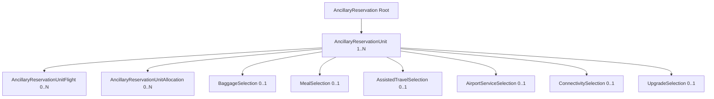

# 04 — Aggregate/VO/Persistence: نقشه سورس‌واقعی

## نمودار مرز

## Root `Domain/AncillaryReservationAggregate/AncillaryReservation.cs`
| Field | CLR type | invariant/behavior |
|---|---|---|
| Id | long | generated HoldId |
| IdempotencyKey | string ≤128 | unique Create identity |
| OrderId | long | positive, correlation only |
| Reference | string ≤128 | immutable |
| RequestedExpiresAt / ExpiresAt | DateTimeOffset? | future on Create, historical after Confirm |
| Status | AncillaryReservationStatus | Derived by `Settle`, transition held/confirmed/released/expired/cancelled |
| CreatedAt, UpdatedAt | DateTimeOffset | internal audit |
| Units | IReadOnlyCollection<AncillaryReservationUnit> | child list under Root |

**Methods سورس:** `Hold`, `AppendSeats`, `HoldsSeats`, `EnsureSameContent`, `Confirm`, `Release(unitIds?)`, `Cancel(reason,unitIds?)`, `Expire`, `EffectiveStatus`, `StatusOf`. هیچ روش جدید برای Pricing/EMD یا Order validation اضافه نشود.

## Unit `Entities/AncillaryReservationUnit.cs`
| Field | CLR | Source/constraint |
|---|---|---|
| Id, AncillaryReservationId | long | generated/FK |
| OrderServiceId | long | caller, positive, unique در Hold |
| ServiceDefinitionId | long | internal derive از Provision |
| ProvisionId | long | caller locator |
| VariantCode | string max8 | internal Definition; member of A01..A24 |
| ServiceDefinitionRef | string max30 | snapshot Catalogue برای Plan/Package/GET |
| TravellerId | long? | Caller، Scope Order → null |
| CoverageScope | ServiceCoverageScope | **internal** derived، نه Wire |
| Flights/CoveredFlightIds | child FlightId:long[] | positive distinct; Sector exactly 1 |
| Quantity | int | >0؛ Selected یا fixed Provision bounds |
| SeatMapSelectionId | string? max256 | Seat only، verifier |
| SeatNumber | string? max16 | Seat only، normalized |
| PricingId | long? | internal Seat verifier؛ GET منع |
| Baggage/Meal/AssistedTravel/AirportService/Connectivity/Upgrade | owned typed selections | حداکثر یک Family فعال؛ immutable |
| StockPoolId, ProviderUnitRef | legacy nullable | outbound/get generic ممنوع تا provider واقعی |
| AppendIdempotencyKey | string? max128 | Seat append only |
| Status | AncillaryReservationUnitStatus | Held/Confirmed/Released/Expired/Cancelled |
| CancellationReasonCode | string? max50 | cancel persisted |
| Allocations | child list | local ledger only |

## Owned types و fields موجود در HEAD
- `BaggageSelection`: `BagRef:string?`, `MeasuredWeightKg:decimal?`, `Dimensions:SelectedDimensions?`, `WeightKg:decimal?`, `EquipmentKind:string?`. `SelectedDimensions`: `LengthCm`, `WidthCm`, `HeightCm` decimals.
- `MealSelection`: `MealCode:string?`, `MenuItemRef:string?` ثابت در Hold.
- `AssistedTravelSelection`: `AssistanceSsrCode:string`.
- `AirportServiceSelection`: `TimeWithOffset:DateTimeOffset?`, `GuestCount:int?`, `AirportId:int`, `FacilityId:long?` (نام بر اساس `AncillaryReservationSelectionArgs`/Owned source).
- `ConnectivitySelection`: `DeviceCount:int?`.
- `UpgradeSelection`: `ToCabinId:int`.
- **Priority** در Source v11 owned table جدا ندارد؛ انتخاب true از Rule و Unit/Variant است؛ ساخت یک Priority entity خالی ممنوع.
- **Pet/Medical/UMNR/Bassinet** به علت GATED details persist ندارند؛ داده ساختگی به VO اضافه نشود.

## InventoryAllocation
`AncillaryReservationUnitAllocation`: `Id:long`, `AncillaryReservationUnitId:long`, `ResourceKind` (existing enum), `InventorySourceId:long`, `Amount:decimal`. ستون Amount طبق قرارداد v11 و SQL mapping کنترل شود؛ آستانه Count/Slot integer، Weight decimal. Usage حاصل از Allocations Unitهای Held غیرمنقضی + Confirmed است، نه کاهش TotalCapacity یا counter موقت.

## جداول و Migration در HEAD
مایگریشن موجود: `20261026190047_V11ReservationSelections`. طبق گزارش v11، ۷ جدول relational child ایجاد شده‌اند:
1. `AncillaryReservationUnitFlights`
2. `AncillaryReservationUnitBaggageSelections`
3. `AncillaryReservationUnitMealSelections`
4. `AncillaryReservationUnitAssistedTravelSelections`
5. `AncillaryReservationUnitAirportServiceSelections`
6. `AncillaryReservationUnitConnectivitySelections`
7. `AncillaryReservationUnitUpgradeSelections`

`AncillaryReservationUnits` دارای `VariantCode`/`ServiceDefinitionRef` و سایر ستون‌های Header است. `CoveredFlightIds` قدیمی از JSON nvarchar(max) به جدول child منتقل شده است. Baggage measure columns در EF Source precision `(18,3)` دارند، نه فرض نادرست `(19,3)`؛ Migration واقعی مرجع Precision است. `EF OwnsOne` و `OwnsMany` مطابق `AncillaryReservationUnitConfiguration.cs`؛ `UsePropertyAccessMode(Field)` برای collectionها. هیچ یک از جدول‌های اضافه را بدون evidence حذف نکن.

## محدودیت Migration
در v11 بر اساس تصمیم Owner دیتای Reservation Dev تستی و خالی‌سازی پیش از Migration مجاز بوده؛ این **مجوز برای پاک‌سازی دیتابیس‌های دیگر یا production نیست**. اگر HEAD فعلی Applied است، هیچ Drop/Rename مجدد نساز. اگر Schema روی محیطی قدیمی است، ابتدا data count/constraints/foreign keys، script idempotent و restore plan گزارش؛ هیچ migration بدون owner consent. Status enum numberها تغییر نکنند.

## دامنه و صحت Rehydration
1. از همان Root، Unit و Owned children load کن؛ هیچ query روی current Definition هنگام GET.
2. Fixed selection را فقط در Create snapshot کن؛ تغییر Definition/Provision باید historical value را ثابت بگذارد.
3. `IsSelectedBy` و `EnsureSameContent` بر Selected input واقعی (نه فقط IDs) آزمون شوند؛ static fixed fact در Idempotency پس از Retirement نباید وابسته به Catalog live باشد.
4. Empty VO rows فقط برای storage convenience نساز؛ invalid Family combinations رد شوند.
